# คู่มือการใช้งานหน้าจอ — Man-day Scorecard (v2026.11 · มุมชนะชัย / Admin)

เอกสารนี้เป็น**คู่มือหน้าจอฉบับปัจจุบัน** แคปจอโหมดสว่าง (Light Mode · `1600×1050`) ด้วยบัญชี Dev Login **ชนะชัย** (`chanachai` · สิทธิ์ `admin`) ไล่ทีละหน้าพร้อมคำอธิบายการทำงาน

**อ้างอิง:** [คู่มือ.md](./คู่มือ.md) · [ระบบ.md](./ระบบ.md) · Checklist: [checklist-ทดสอบมือ.md](./checklist-ทดสอบมือ.md)  
**แคปจอ:** `docs/manual-screenshots/` · สคริปต์: `node scripts/capture_all_screens.mjs --person=chanachai`  
**PDF:** `node scripts/build-manual-pdf.mjs` → [คู่มือการใช้งานระบบ.pdf](./คู่มือการใช้งานระบบ.pdf)

> หมายเหตุสิทธิ์: คู่มือนี้โฟกัสมุม **Admin (ชนะชัย)** — เมนูตั้งค่าระบบโผล่ครบ · หากสลับเป็น persona Member เมนูแอดมินจะหายและเห็นเฉพาะงานของตน

---

## ภาพรวมโครงสร้างและการนำทาง (ที่ชนะชัยเห็น)

- **Sidebar เดียวตามสิทธิ์**: งานของฉัน · ภาพรวมงาน · ทีมของฉัน · งานทีม · Git & MR · ปฏิทิน · คะแนน & วิเคราะห์ · คนในทีม · **ตั้งค่าระบบ** (สิทธิ์ & ตั้งค่า · พนักงาน & ทีม · โปรเจกต์ · เกณฑ์คะแนน · ตรวจก่อนล็อก · เชื่อมต่อระบบ · Teams)
- **หลังล็อกอิน:** ทุกสิทธิ์ไป **`/me`** ก่อนเสมอ
- **คีย์ลัด:** `Ctrl+B` ยุบ Sidebar · `Ctrl+K` Omnisearch (ใบงาน / คน / โปรเจกต์ / เมนู)
- **Global Filter:** โผล่บนหน้าศูนย์กลาง (`/work`, `/team`, `/cockpit`, `/people`, `/quality`, `/mygit`, `/schedule`) — ซ่อนบน `/me` และหน้า Admin
- **รายละเอียดใบงานกลาง:** ทุกจุด「ดูใบงาน」เปิด drawer ขวาชุดเดียว (`TicketDetailService`) — ยกเว้น Board คลิกการ์ดยังเป็น dialog แก้ไขแผน

### แผนที่ข้อมูล myProject → หน้า Scorecard (พนักงาน)

| โมดูล / ข้อมูลบน myProject | ใช้บน Scorecard | หมายเหตุ |
|---|---|---|
| Work packages (id · subject · type · status · assignee · project · **priority** · dates · estimate/spent) | `/me` · `/work` · drawer | แหล่งความจริงของใบงาน |
| Types / Statuses | Board workflow · typeMap/statusMap | ตั้ง mapping ที่ `/integrations` |
| Users + CF แผนก/ฝ่าย/ตำแหน่ง | คนในทีม · สิทธิ์ · staging | `sync-users` |
| Projects catalog | Global Filter · `/admin/projects` | Smart Merge |
| Policy/SLA CF (Receipt/Reply/Plan/Due/Alert/Policy) | drawer · แจ้งเตือน | Auto-SLA ไม่ทับ myProject |
| **Unit Test / Check pass CF** | drawer Overview (อ่านอย่างเดียว) | discover ที่ Integrations · ไม่ writeback |
| Time entries | drawer แท็บเวลา · `/work/team-time` | hours → MD |
| Activity / Files / Relations / Watchers | drawer แท็บคู่ OP | ดึงสดตอนเปิดรายละเอียด |
| GitLab MR / Branch | `/mygit` · drawer แท็บโค้ด | ไม่ใช่โมดูล OP |
| News · Meetings · OP Calendars/Team planners · Admin · Costs | — | **ไม่**ดึงเป็นแกนของเว็บ Scorecard |

---

## สารบัญ

| ส่วน | หน้าจอ | Route | รูป |
|---|---|---|---|
| 1 | เข้าสู่ระบบ | `/login` | 01 |
| 2 | งานของฉัน | `/me` | 02 |
| 3–4 | ภาพรวมงาน | `/cockpit` | 03–04 |
| 5 | แดชบอร์ดทีม | `/team` | 05 |
| 6–8 | คน / พนักงาน / ทีม | `/workspace/people` · `/people` · `/org/teams` | 06–08 |
| 9–13c | งานทีม (สรุป→เวลา) | `/work/*` | 09–13c |
| 12b | Drawer ใบงาน 360° | จาก list/อื่น | 12b |
| 14 | ปฏิทิน | `/schedule` | 14 |
| 15–21 | คุณภาพ · คะแนน · Git · AI | `/quality/*` · `/mygit` | 15–21 |
| 22–27 | Admin · Integrations · Projects | `/admin*` · `/integrations` · `/teams` | 22–27 |
| 25b | Sync-audit myProject | `/integrations` | 25b |
| 28 | รายละเอียดโปรเจกต์ | `/org/projects/:id` | 28* |
| 29 | โหมดจำลอง | `/quality/mockup` | 29 |

---

## ส่วนที่ 1: เข้าสู่ระบบ

### 1. เข้าสู่ระบบ (`/login`)

| | |
|---|---|
| **จุดประสงค์** | เลือกบัญชี Dev หรือ SSO เพื่อเข้าแอป |
| **สิ่งที่เห็น** | การ์ด/ชิปพนักงาน (ค้นหาได้) · แท็บ GitLab OAuth |
| **ปุ่มสำคัญ** | ชิป **ชนะชัย** (Dev Quick Login) · ปุ่ม SSO |
| **ผลเมื่อกด** | เข้าสู่ระบบ → ไป **`/me`** ทันที |
| **สิทธิ์ admin** | หลังเข้าจะเห็นเมนูตั้งค่าระบบครบบน Sidebar |

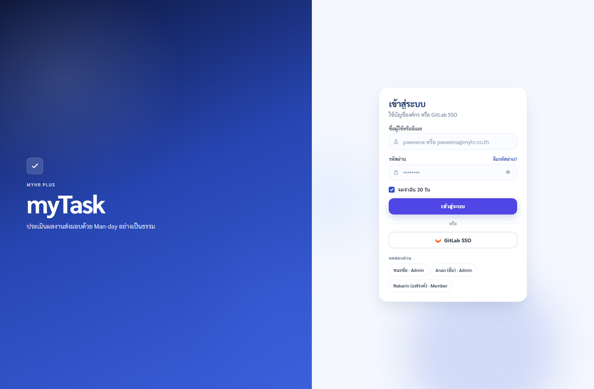

---

## ส่วนที่ 2: งานของฉัน (Landing)

### 2. งานของฉัน (`/me`)

| | |
|---|---|
| **จุดประสงค์** | หน้าแรกหลังล็อกอิน — ดูผลงานและงานเปิดของ**ตัวเอง**ก่อน |
| **สิ่งที่เห็น** | โปรไฟล์ · ดัชนีพัฒนาการเทียบเป้าตัวเอง · งานเปิด/ปิด · เป้า MD สัปดาห์ · คำแนะนำสั้น |
| **ปุ่ม/ลิงก์** | คลิกใบงาน → เปิด drawer 360° · ลิงก์ไปงานทีม/คุณภาพจากเมนู |
| **ผลเมื่อกด** | ไม่จัดอันดับเทียบคนอื่น — โฟกัสงานของชนะชัย |
| **สิทธิ์ admin** | ใช้หน้านี้เหมือน member แต่สลับไปเมนูทีม/แอดมินได้ทันทีจาก Sidebar |

### 3–4. ภาพรวมงาน (`/cockpit`)

| | |
|---|---|
| **จุดประสงค์** | แดชบอร์ดภาพรวมทีม/องค์กร (Bento) สำหรับ Lead/Admin |
| **สิ่งที่เห็น** | KPI ภาระงาน · แนวโน้มคะแนน · คุณภาพส่งมอบ · Stage Aging · Risk Radar · โหมดทีวี |
| **ปุ่มสำคัญ** | TV Mode · Maximize กราฟ · คลิกโดนัท/ใบงานเพื่อเจาะหน้าปลายทางพร้อมฟิลเตอร์ |
| **ผลเมื่อกด** | Global Filter (ทีม/คน/สาย) มีผลกับตัวเลขบนหน้า |
| **สิทธิ์ admin** | เห็นทั้งองค์กรตาม `allowedTeams` / staging |

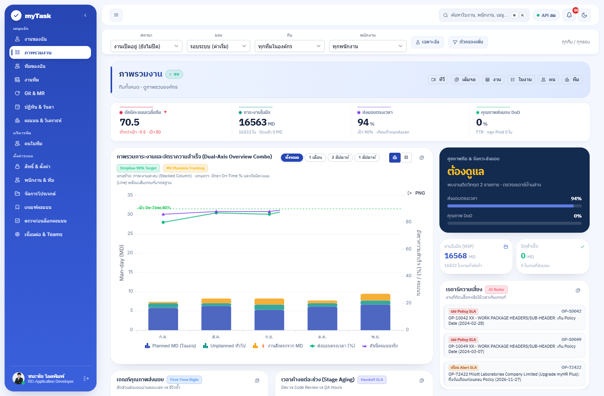

---

## ส่วนที่ 3: ทีม & คน

### 5. แดชบอร์ดทีม (`/team`)

| | |
|---|---|
| **จุดประสงค์** | วิเคราะห์ดัชนีทีม โควตา Planned vs Unplanned vs MD |
| **สิ่งที่เห็น** | กราฟดัชนี · Donut ชนิดงาน · KPI Snapshot ย้อนหลัง · บล็อกทีมที่ดูแล |
| **ปุ่มสำคัญ** | คลิกสมาชิก → Person Workspace |
| **สิทธิ์ admin** | เห็นทีมตามขอบเขตสิทธิ์ข้ามแผนก |

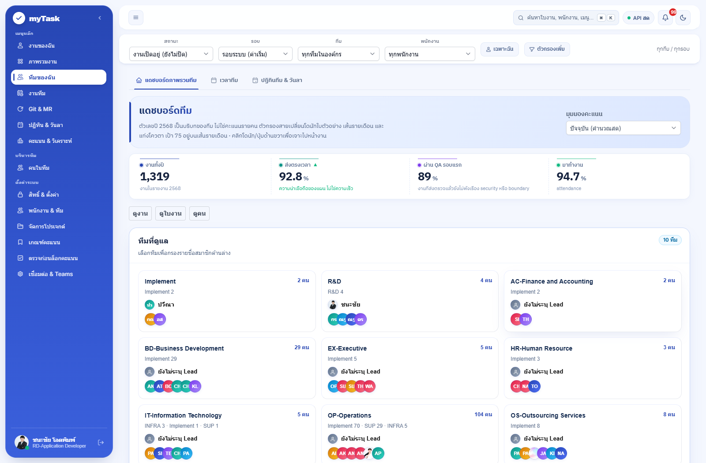

### 6. พนักงาน & ทีม — Directory (`/workspace/people`)

| | |
|---|---|
| **จุดประสงค์** | ตะแกรงนามบัตรคน → เข้า Workspace รายบุคคล |
| **สิ่งที่เห็น** | การ์ดคน (รูป · สาย · WIP · ดัชนี) · แท็บ **พนักงาน \| ทีม** (admin) |
| **ปุ่มสำคัญ** | คลิกการ์ด → `/workspace/people/:personId` · แท็บทีม = การ์ดทีม |
| **ผลเมื่อกด** | ไม่กรองรายชื่อด้วย route personId — directory แสดงทั้งชุดตามสิทธิ์ |

### 7. ตารางดัชนีพนักงาน (`/people`)

| | |
|---|---|
| **จุดประสงค์** | เปรียบเทียบดัชนี/โควตาแบบตาราง + กราฟ |
| **สิ่งที่เห็น** | DataGrid (ตรึงชื่อ+อวาตาร์) · progress ในเซลล์ · Export |
| **ปุ่มสำคัญ** | คลิกชื่อ → โปรไฟล์/Workspace |

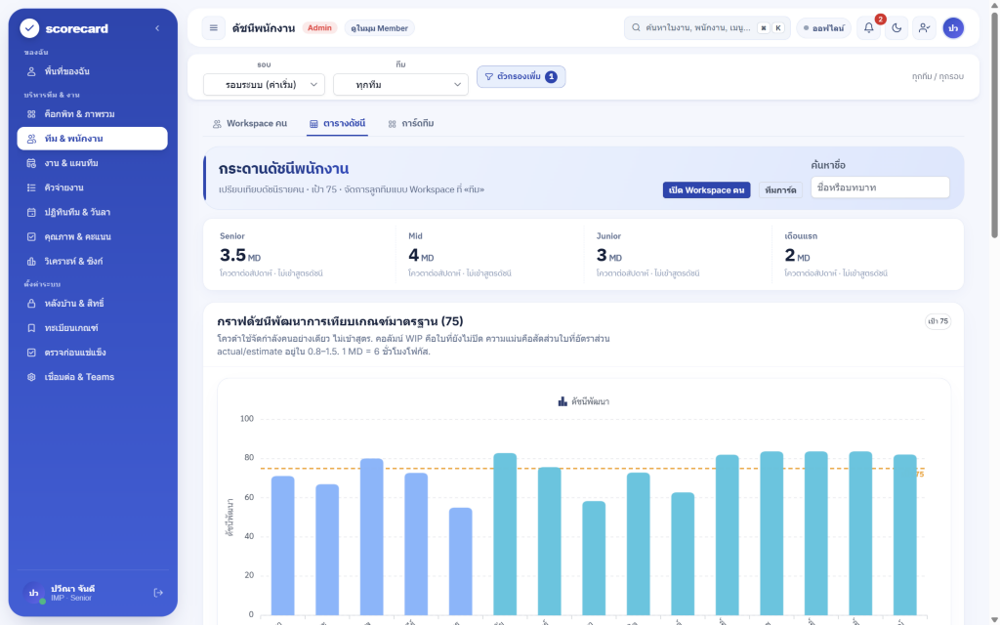

### 8. แท็บทีม (`/org/teams` → `/workspace/people?view=teams`)

| | |
|---|---|
| **จุดประสงค์** | เลือกทีมจากชุดเดียวกับพนักงาน & ทีม (ไม่ซ้ำการ์ดบน rail) |
| **ผลเมื่อกด** | ตั้ง `teamId` ใน Global Filter แล้วกลับมุมพนักงาน |

### Person Workspace ของชนะชัย (`/workspace/people/chanachai`)

| | |
|---|---|
| **จุดประสงค์** | ห้องทำงานรายคน — ภาพรวม · งาน · คะแนน · Git & โค้ด |
| **ปุ่มสำคัญ** | Employee switcher สลับคน · กลับ directory · เปิดใบงานใน drawer |

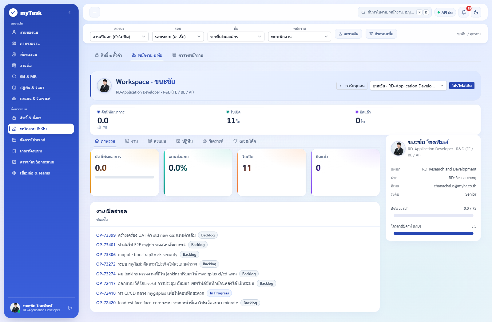

---

## ส่วนที่ 4: งานทีม (`/work`)

ตัวกรองหน้านี้เป็นของ Local (สัปดาห์/ถังวัน/ค้นหา) — **ไม่ persist ทีม/สาย** (ทีม/สายอยู่ Global Filter)

### 9. สรุปงานค้าง (`/work/summary`)

| | |
|---|---|
| **จุดประสงค์** | จัดงานค้างตามถังวันส่ง (เกินกำหนด / วันนี้ / …) |
| **สิ่งที่เห็น** | การ์ดถัง · ป้าย MD-DIRECT · ชิปสัปดาห์ |
| **ผลเมื่อกดใบ** | เปิด drawer 360° |

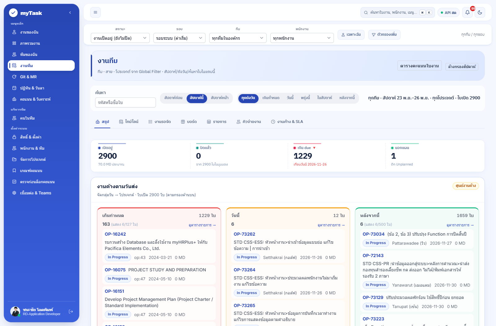

### 9b. งานรอจัด (`/work/backlog`)

| | |
|---|---|
| **จุดประสงค์** | ใบที่ยังไม่เข้า pipeline / รอจัดคิว |
| **ปุ่มสำคัญ** | เปิดรายละเอียด · ส่งต่อไปคิว |

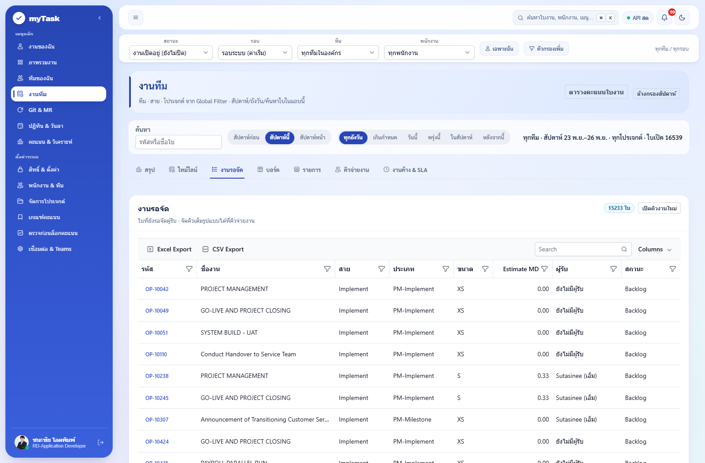

### 10. บอร์ด Kanban (`/work/board`)

| | |
|---|---|
| **จุดประสงค์** | ย้ายสถานะงานแบบลากวาง |
| **สิ่งที่เห็น** | คอลัมน์ workflow · ป้าย MD-DIRECT / MR / Reopen |
| **ปุ่มสำคัญ** | **คลิกการ์ด** = dialog แก้แผน (admin/lead) · **ดูรายละเอียด 360°** = drawer กลาง |
| **สิทธิ์** | Admin/Lead ย้ายถึง Done ได้ · Member ห้ามปิด Done เอง |

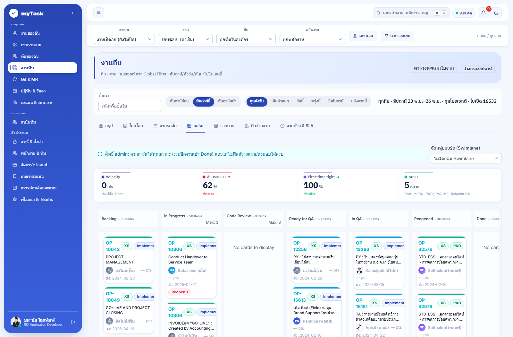

### 11. ไทม์ไลน์ Gantt (`/work/timeline`)

| | |
|---|---|
| **จุดประสงค์** | แผนวันเริ่ม–ส่ง · มุมโครงงาน / ตามคน |
| **ปุ่มสำคัญ** | สลับ ProjectView / ResourceView · ลากวัน (admin/lead) — **ไม่ทับ `firstDueOn`** |
| **ผลเมื่อกดแถว/แท่ง** | เปิด drawer |

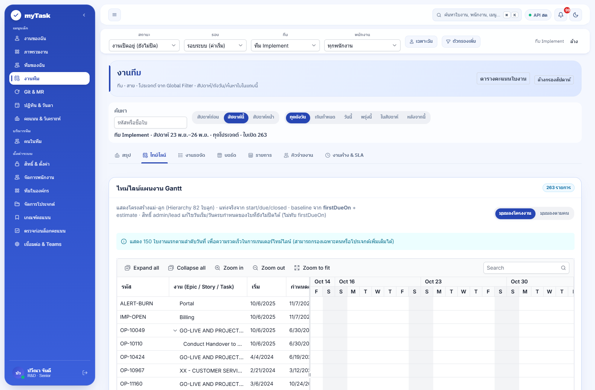

### 12. รายการใบงาน (`/work/list`)

| | |
|---|---|
| **จุดประสงค์** | ตารางปฏิบัติการ + คอลัมน์ Policy/SLA |
| **ปุ่มสำคัญ** | คลิกรหัสใบ → drawer · Export Excel/CSV · Column chooser |
| **สิทธิ์ admin** | เห็นทุกทีมตามฟิลเตอร์ |

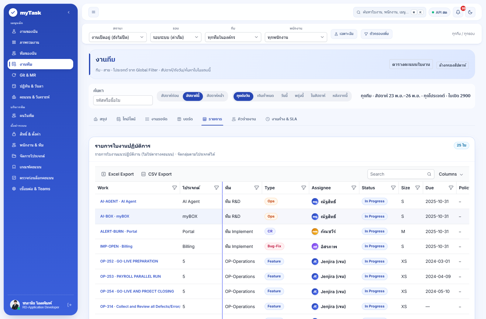

### 12b. Drawer รายละเอียดใบงาน 360° (มาตรฐานเดียวกัน)

| | |
|---|---|
| **จุดประสงค์** | ดูใบงานจากทุกจุดด้วย UI ชุดเดียว แนว myProject |
| **สิ่งที่เห็นบนหัว** | Type (เช่น Ops) · ชื่อเรื่อง · status workflow (+ opStatus) · ผู้สร้าง/วันอัปเดต · แถบโปรเจกต์ · ลิงก์ myProject |
| **แท็บ** | ภาพรวม · ความเคลื่อนไหว · ไฟล์ · ความสัมพันธ์ · คนเกี่ยวข้อง · เวลา · โค้ด & MR |
| **ภาพรวม** | คำอธิบาย · สาย/ขนาด/**Priority**/Estimate/Actual/Due · **DoD จาก myProject (Unit Test / Check pass อ่านอย่างเดียว)** · คะแนนย่อ · กล่อง Policy & SLA (+ ป้าย Auto) |
| **โค้ด & MR** | รายการ MR ที่จับคู่ · **สร้าง branch บน mygit** (เมื่อมี `opId`) — เลือก repo · ชื่อ `feat/OP-{id}-…` · สร้างจาก ref (ค่าเริ่ม default branch / `main`) |
| **ผลเมื่อกดความสัมพันธ์** | เปิดใบที่เกี่ยวข้องใน drawer ชุดเดิม |
| **Writeback** | ลงเวลา/คอมเมนต์ใช้ได้เมื่อ `OPENPROJECT_WRITEBACK=true` |

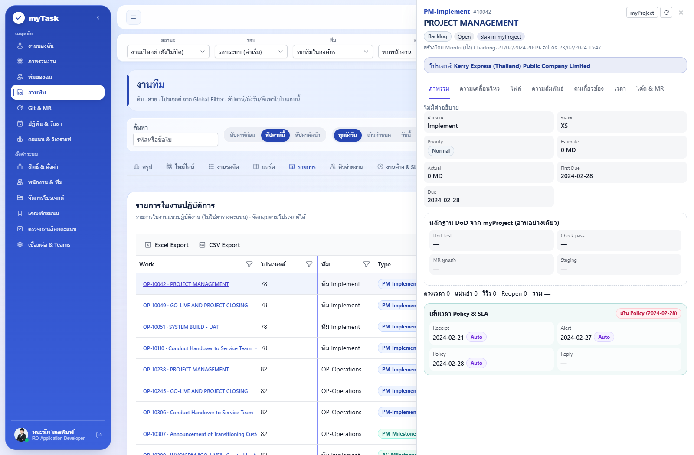

### 13. คิวจ่ายงาน (`/work/queue`)

| | |
|---|---|
| **จุดประสงค์** | จ่ายงานให้คนตามโควตา |
| **ปุ่มสำคัญ** | รับข้อเสนอคิว · ยืนยัน writeback assignee เมื่อมี `opId` |
| **สิทธิ์** | เฉพาะ admin \| lead |

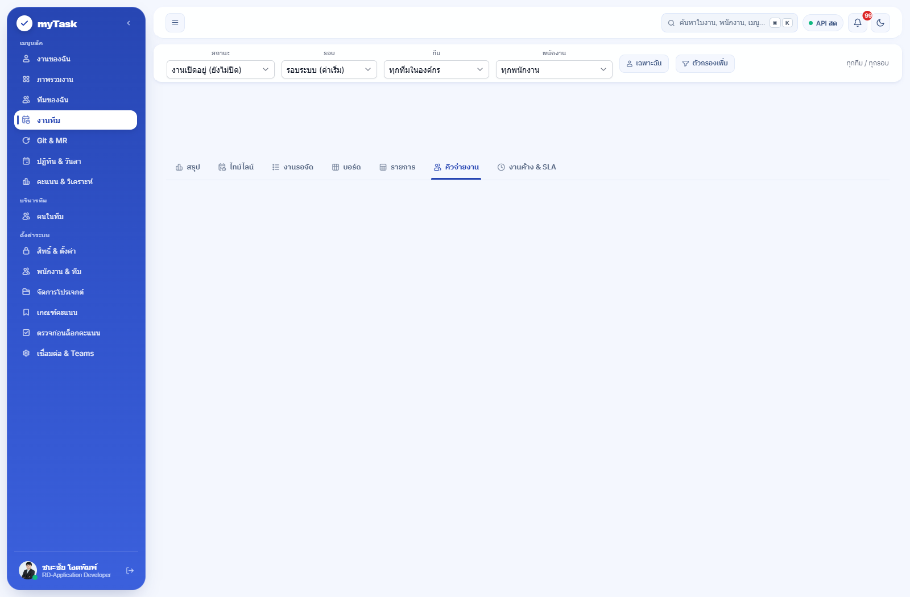

### 13b. งานค้าง & SLA (`/work/handoff`)

| | |
|---|---|
| **จุดประสงค์** | Stage aging · blocker · ping Teams |
| **ปุ่มสำคัญ** | เปิดใบใน drawer · Ping SLA |

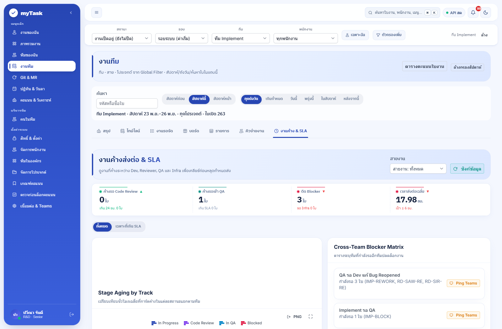

### 13c. เวลาทีมรายวัน (`/work/team-time`)

| | |
|---|---|
| **จุดประสงค์** | Timesheet matrix จ–ศ ของทีม |

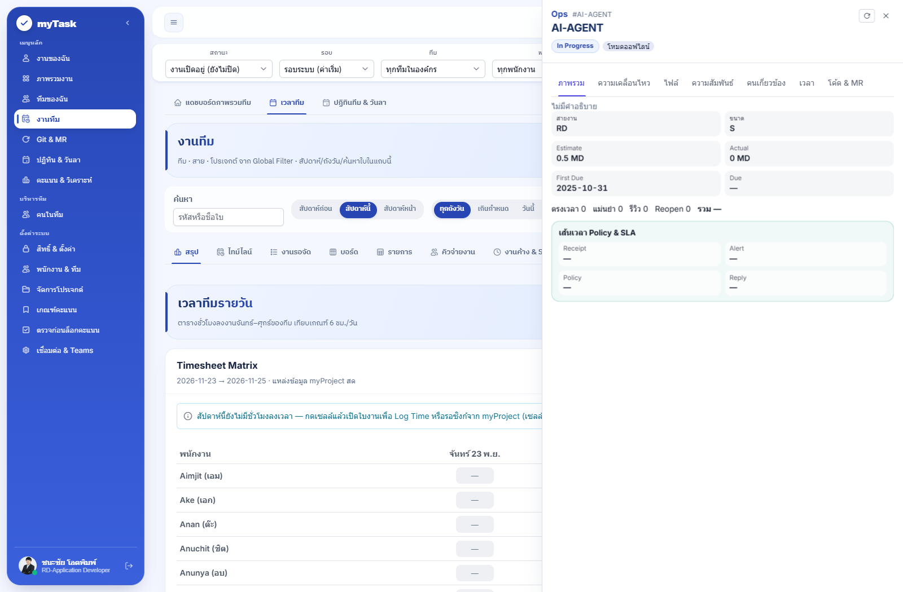

### 14. ปฏิทิน & วันลา (`/schedule`)

| | |
|---|---|
| **จุดประสงค์** | ปฏิทินกำหนดส่งรายคน |
| **หมายเหตุ** | แผงรายวันในหน้า ≠ drawer Over — คลิกใบยังเปิด drawer กลางได้ |

---

## ส่วนที่ 5: คะแนน & คุณภาพ

### 15. ตรวจคุณภาพ QA (`/quality/audit`)

| | |
|---|---|
| **จุดประสงค์** | DoD Gate · Pareto reopen · ส่งกลับ Dev |
| **ปุ่มสำคัญ** | เปิดใบ 360° · Reject to Dev |

### 16. ตารางคะแนน (`/quality/tickets`)

| | |
|---|---|
| **จุดประสงค์** | คะแนนเต็ม 100 รายใบ (ตรงเวลา 40 · แม่นยำ 20 · รีวิว 20 · Reopen/DoD 20) |
| **ปุ่มสำคัญ** | คลิกรหัส → drawer · นำเข้า · Export · ซิงก์ |

### 16b. OLS / สรุป AI (`/quality/ols`)

วิเคราะห์แนวโน้มดัชนีและ coaching สรุปทีม

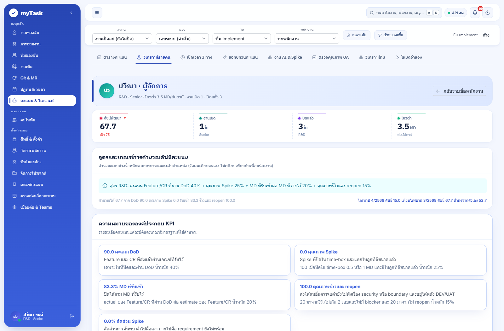

### 17. เช็กเวลา 3 ทาง (`/quality/time-audit`)

Estimate vs Actual (OP) vs Git Commit Span — จับ outlier การประเมินขนาด

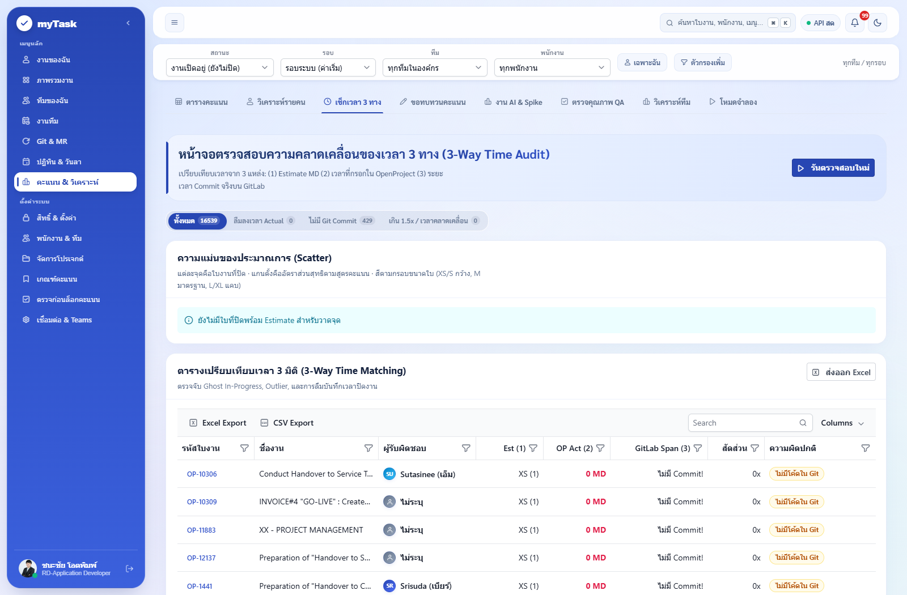

### 18. ขอทบทวนคะแนน (`/quality/disputes`)

Split-pane: รายการคำขอซ้าย · คำนวณ projected score ขวา · อนุมัติ/ปฏิเสธ (lead/admin)

### 19. วิเคราะห์ทีม (`/quality/report`)

Python Analytics Hub — hygiene · outlier · coaching

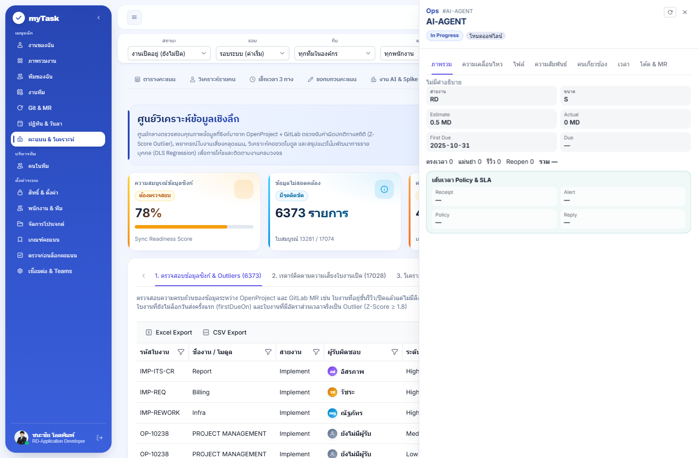

### 20. Git & MR (`/mygit`)

| | |
|---|---|
| **จุดประสงค์** | ซิงก์ MR จาก GitLab · จับคู่ใบงาน · CI / รีวิว |
| **โฟลว์ A** | Branch ยังไม่มีใบ → การ์ด Unmatched · ปุ่ม `+ สร้างใบงาน` → สร้าง Work Package บน myProject แล้วผูก |
| **โฟลว์ B** | มีใบงานแล้ว → เปิด drawer แท็บ「โค้ด & MR」→ **สร้าง branch** ตาม `feat/OP-{id}-…` บน mygit |
| **หมายเหตุ** | ฟีเจอร์ Git อยู่ที่ Scorecard + GitLab — ไม่พึ่ง OpenProject writeback |

### 21. งาน AI & Spike (`/quality/ai`)

ติดตามสัดส่วน MD งานวิจัย/Spike/AI

---

## ส่วนที่ 6: ตั้งค่าระบบ (Admin — ชนะชัย)

Global Filter ซ่อนในกลุ่มนี้

### 22. สิทธิ์ & ตั้งค่า (`/admin`)

| | |
|---|---|
| **จุดประสงค์** | รอบประเมิน · โควตา · น้ำหนักคะแนน · Role Matrix · Audit Log |
| **ปุ่มสำคัญ** | เปิดรอบปี · ตั้งเป็นรอบระบบ · ปรับ access รายคน |
| **ผลเมื่อกด** | รอบระบบไปโผล่บน Global Filter ทั้งแอป |

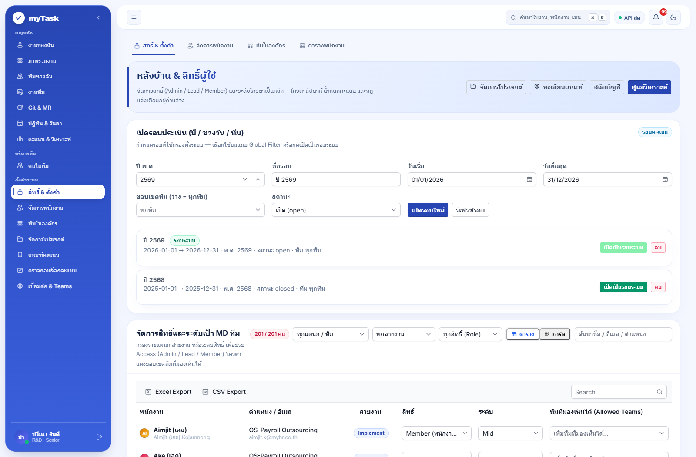

### 23. เกณฑ์คะแนน (`/admin/rubrics`)

ทะเบียนสูตร 6 สาย (IMP/RND/QA/UXBA/SUP/INFRA) แก้ inline

### 24. ตรวจก่อนล็อกคะแนน (`/admin/snapshot-check`)

Readiness % + 4 Gates · Preview Diff ก่อนจับ KPI Snapshot

### 25. เชื่อมต่อระบบภายนอก (`/integrations`)

| | |
|---|---|
| **จุดประสงค์** | ตั้ง OpenProject · GitLab · Teams |
| **OpenProject** | URL/Token · โปรเจกต์ซิงก์ · statusMap/typeMap · CF & Auto-SLA · **กลุ่ม roster (`people.active`)** · ปุ่มซิงก์ใบงาน / ซิงค์พนักงาน |
| **ปุ่มสำคัญ** | ดึงโปรเจกต์/สถานะ · สแกน CF · Sync OpenProject · ซิงค์พนักงาน · บันทึก |
| **ผลเมื่อกดซิงค์พนักงาน** | ถ้าตั้ง roster groups → เปิด active เฉพาะสมาชิกกลุ่ม (ไม่ลบแถวคนอื่น) |

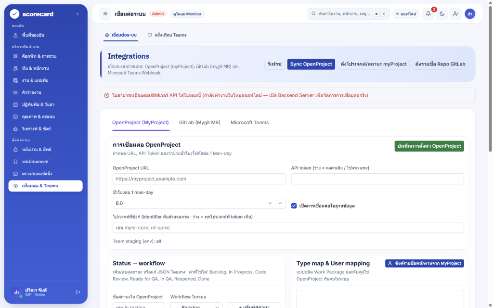

### 25b. รายงานเทียบซิงก์ (sync-audit)

| | |
|---|---|
| **จุดประสงค์** | อ่านอย่างเดียว — เทียบ Users/Groups/Types/Status/CF/Enumerations กับ API จริงก่อนเปลี่ยน DB |
| **ปุ่มสำคัญ** | **ตรวจซิงก์สด** |
| **สิ่งที่เห็น** | คน active ไม่อยู่ใน roster · type/status ที่ยังไม่แมป · CF สำคัญ 43/44/45/46/163/185/219 · enumerations |

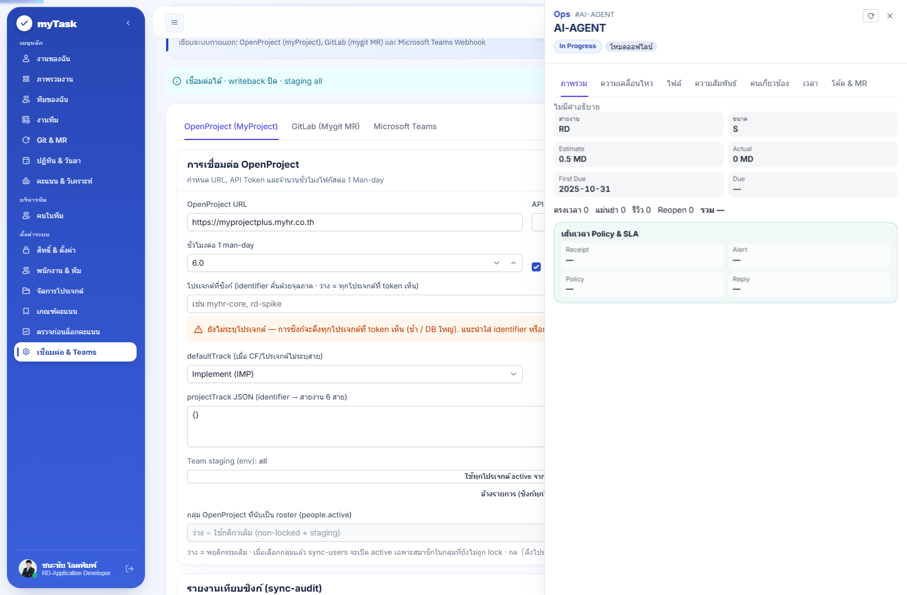

### 26. แจ้งเตือน Microsoft Teams (`/teams`)

Webhook สรุปงานค้าง/SLA · ทดสอบส่ง · ประวัติ

### 27. จัดการโปรเจกต์ (`/admin/projects`)

Smart Merge จาก myProject · Active toggle · Assigned teams · ลิงก์ไปรายละเอียดโปรเจกต์

---

## ส่วนที่ 7: รายละเอียดโปรเจกต์ & โหมดจำลอง

### 28. ศูนย์โปรเจกต์ (`/org/projects/:id`) — 4 แท็บ

1. **ภาพรวม & สุขภาพ** — KPI MD · Stage · Track · Risk watchlist  
2. **ใบงาน** — กริด · เปิด drawer  
3. **Git & กิ่งโค้ด** — ผูก repo · CI · สร้างใบจาก unmatched branch  
4. **ทีม & คน**

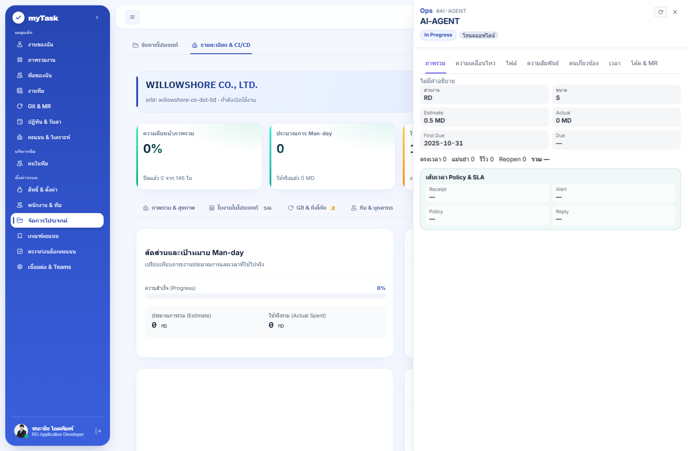

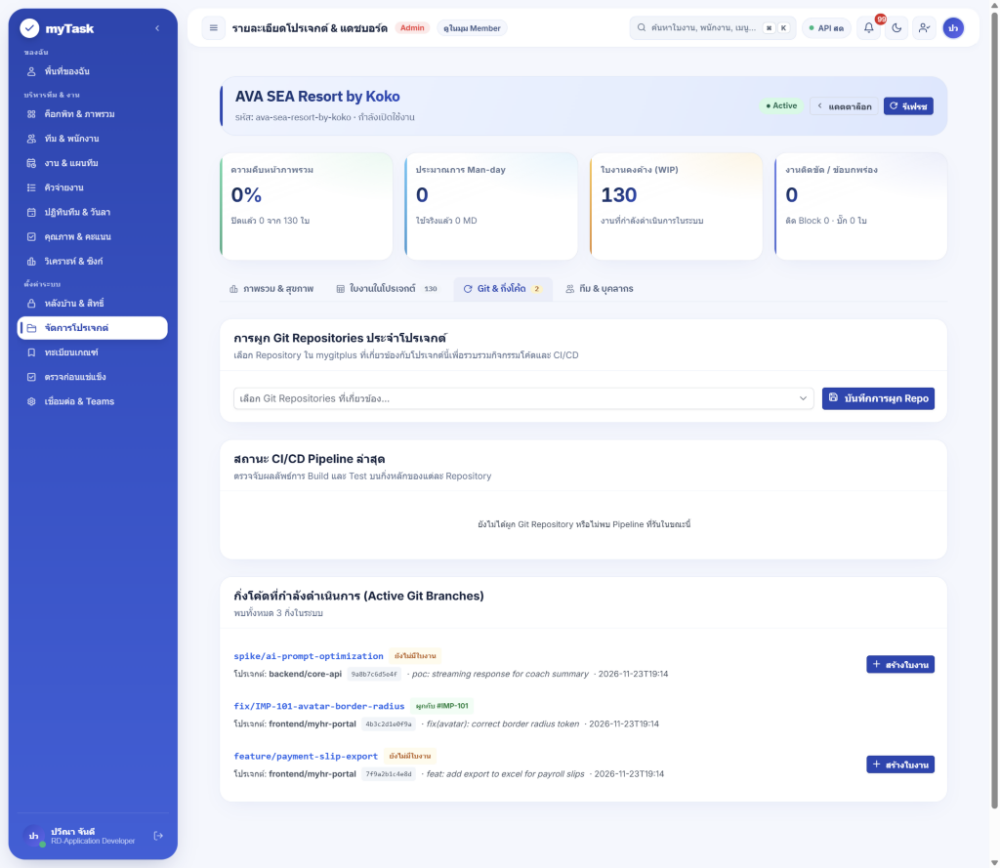

### 29. โหมดจำลอง (`/quality/mockup`)

จำลองใบงาน→คะแนนโดยไม่กระทบข้อมูลจริง — ใช้ทดสอบสูตร/โฟลว์

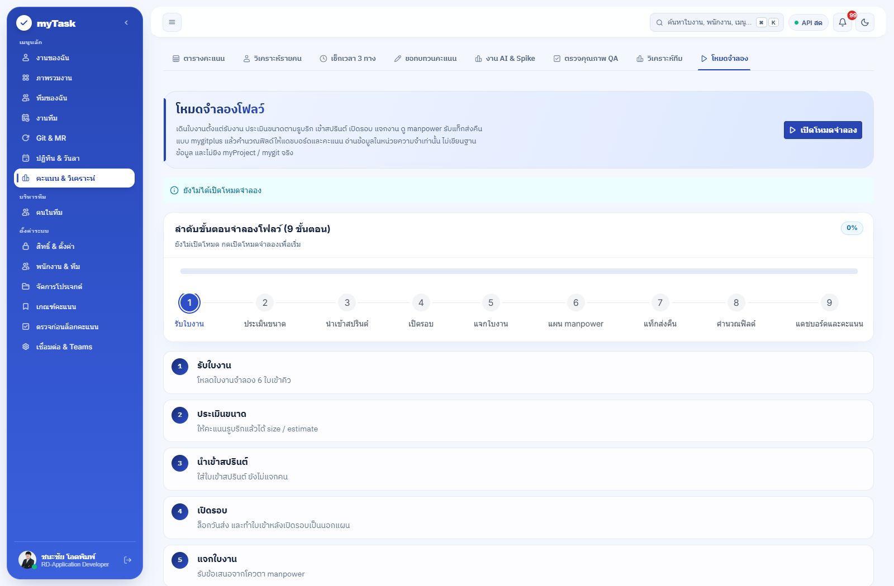

---

## ส่วนเสริม: Policy/SLA · แจ้งเตือน · Type ไดนามิก

รายละเอียดลึกเรื่อง Auto-SLA, ป้าย Auto ใน drawer, กระดิ่ง AppBar, และ catalog type/status จาก myProject ยังใช้อ้างอิงจากแคปเดิม:

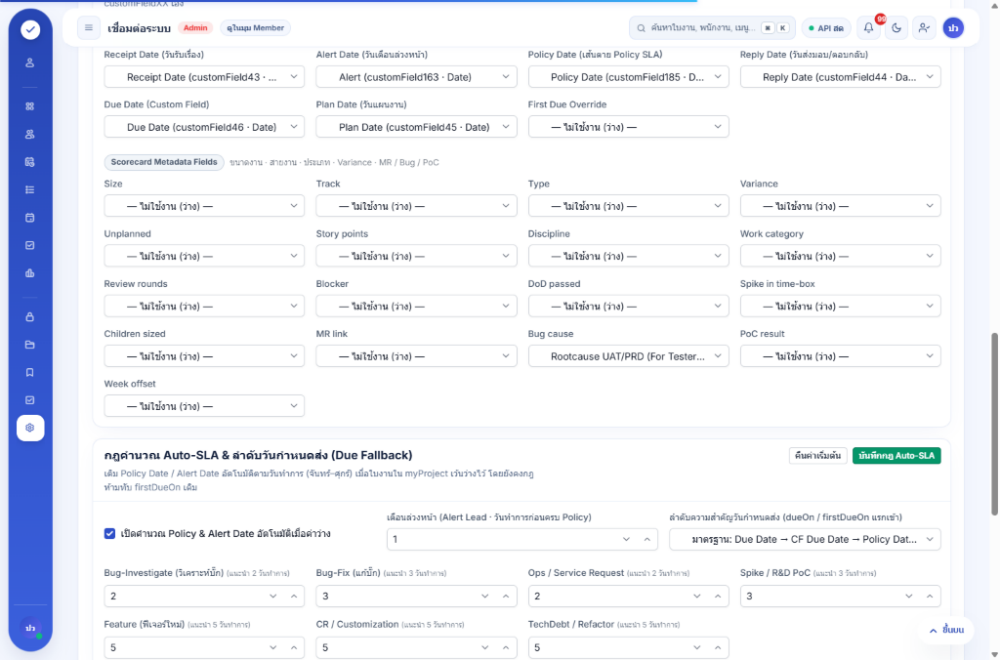
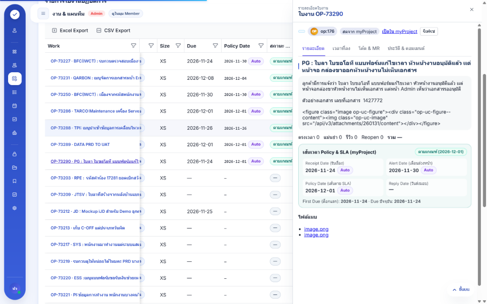
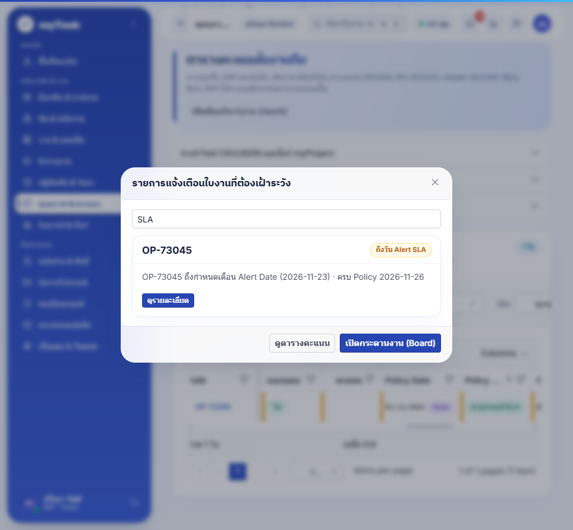
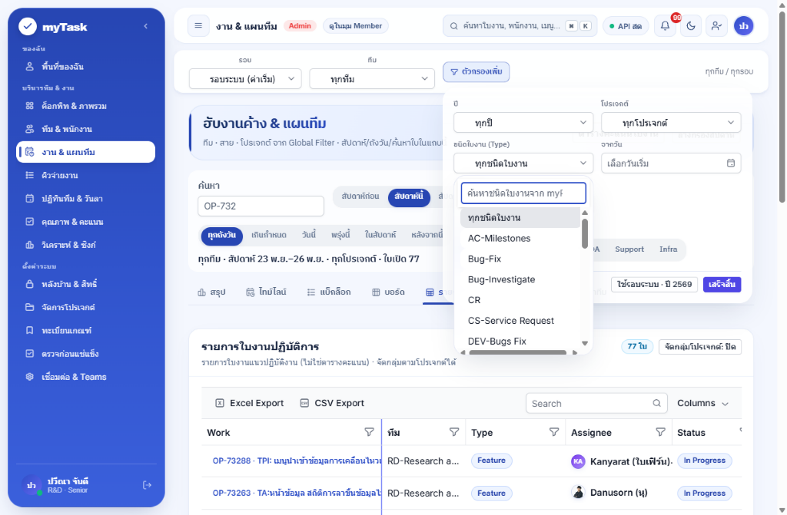

---

## สรุปโฟลว์ที่ชนะชัยใช้บ่อย

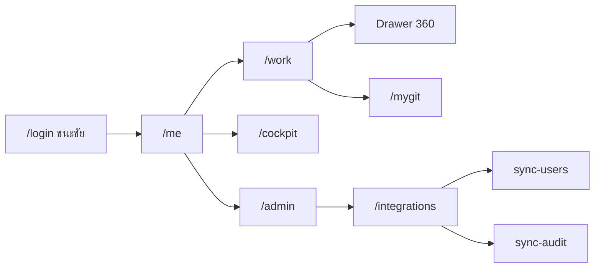

1. ล็อกอินชนะชัย → ดู `/me`  
2. ไป `/work` จัดงาน / เปิด drawer  
3. `/quality/tickets` ตรวจคะแนน  
4. `/integrations` ซิงก์ myProject + ตรวจ sync-audit + ตั้ง roster  
5. `/admin` เปิดรอบประเมิน / ตรวจ snapshot ก่อนล็อกคะแนน  
