# คู่มือการใช้งานหน้าจอ — Man-day Scorecard (โหมดสว่าง / Light Mode)

เอกสารนี้รวบรวมภาพหน้าจอโหมดสว่าง (Light Mode · `1440×900`) และคำอธิบายการใช้งานครบทุก 26 หน้าจอของระบบ **Man-day Scorecard** ตามโครงสร้างเมนูใหม่ (Unified Role-Aware Sidebar + MyHR Royal Blue × Nordic Soft Glass)

---

## ภาพรวมโครงสร้างหน้าจอและการนำทาง

- **Floating Glass Sidebar (แถบเมนูซ้าย)**: แสดงเมนูตามสิทธิ์จริงในแถบเดียว แบ่งหมวดชัดเจนตามการทำงานประจำวัน
  - **Member**: เห็นเมนูส่วนตัว 6 รายการเรียงตรง 2 หมวด (`งานประจำวัน` / `คะแนน & ข้อมูล`)
  - **Lead**: เห็นหมวด `ของฉัน` + `บริหารทีม & งาน` (7 เมนูหลัก)
  - **Admin**: เห็นครบทั้ง `ของฉัน` + `บริหารทีม & งาน` + `ตั้งค่าระบบ` (4 เมนูตั้งค่า)
  - **ปุ่ม `ดูในมุม Member`**: บน AppBar สำหรับ Lead/Admin เพื่อพรีวิวมุมมองพนักงานทั่วไปได้ทันที และกด `กลับโหมดจริง` เพื่อกลับมา
- **คีย์ลัดหลัก**:
  - `Ctrl+B` / `⌘B` — ยุบ/กาง Sidebar เป็น Floating Icon Rail (`64px`) เพื่อเพิ่มพื้นที่ทำงาน (พร้อม Sliding Active Nav Pill เคลื่อนไหวตามเมนูที่เลือก)
  - `Ctrl+K` / `⌘K` — เปิด Omnisearch บน AppBar ค้นหาด่วนข้ามระบบทั้งใบงาน, พนักงาน (พร้อมรูปโปรไฟล์), โปรเจกต์ (ค้นหาได้ทั้งชื่อ, slug และรหัสตัวเลข เช่น `324` หรือ `AVA`), และเมนูทั้งหมดได้ทันที แผงผลลัพธ์จะลอยทับหน้าจออย่างสมบูรณ์โดยไม่ถูกแถบตัวกรองตัดขอบ

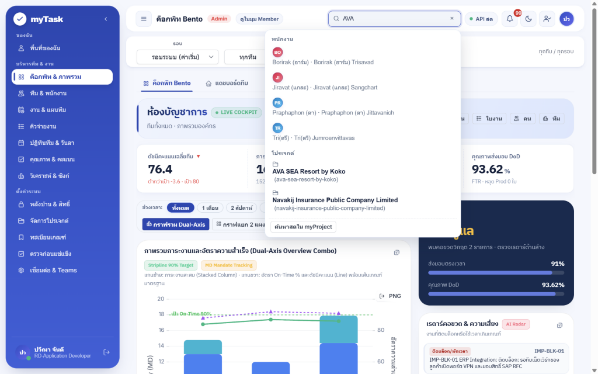
- **แถบ Global Filter 1 แถว (Whitelist Smart Display)**: แสดงเฉพาะหน้าศูนย์กลางข้อมูลและการวิเคราะห์ (`/work`, `/team`, `/cockpit`, `/people`, `/quality`, `/insights`, `/queue`) และซ่อนอัตโนมัติบนหน้าส่วนตัวและแอดมิน เพื่อความสะอาดตา เลือก **รอบประเมิน** และ **ทีม** พร้อมกด **`ตัวกรองเพิ่ม`** เลือก ปี / ช่วงวัน (Syncfusion DatePicker) / โปรเจกต์ / สายงาน 6 รหัส
- **โมชันและการเลื่อนหน้าจอ (Motion Architecture)**: มีเส้นความคืบหน้าการเลื่อนที่ขอบบนสุด (Top Scroll Progress Bar), ปุ่มลูกศรลอยมุมขวาล่างเลื่อนกลับสู่ด้านบน (`Scroll-to-Top`), อนิเมชันเปิดหน้าจอแบบนุ่มนวล (`app-glide-in`), และอนิเมชันเปิดการ์ดเป็นระลอก (`appStagger`)
- **Underline Tab Bar**: แท็บย่อยในแต่ละกลุ่มหน้าจอใช้เส้นใต้สี Royal Blue (`#2746b3`) แยกชัดเจนจากปุ่ม Action

---

## สารบัญหน้าจอทั้ง 28 หน้า

| ส่วน | หน้าจอ | Route | สิทธิ์ |
|---|---|---|---|
| 1. เข้าสู่ระบบ | 1. เข้าสู่ระบบ & สลับบทบาท | `/login` | ทุกคน |
| 2. พื้นที่ของฉัน | 2. ผลงานวันนี้ของฉัน | `/me` | Member / Lead / Admin |
| | 3. ค็อกพิทของฉัน (Personal Bento) | `/me/cockpit` | Member / Lead / Admin |
| 3. ภาพรวม & ทีม | 4. ค็อกพิท Bento (ทีม) | `/cockpit` | Lead / Admin |
| | 5. แดชบอร์ดทีม | `/team` | Lead / Admin |
| | 6. ทีม · Workspace คน | `/workspace/people` | Lead / Admin |
| | 7. กระดานดัชนีพนักงาน | `/people` | Lead / Admin |
| | 8. ทีมในองค์กร (การ์ดทีม) | `/org/teams` | Lead / Admin |
| 4. งาน & แผนทีม | 9. งาน & แผนทีม · สรุป | `/work/summary` | Lead / Admin |
| | 10. บอร์ดงานทีม (Kanban) | `/work/board` | Lead / Admin |
| | 11. ไทม์ไลน์ทีม (Gantt) | `/work/timeline` | Lead / Admin |
| | 12. รายการใบงาน (Work List) | `/work/list` | Lead / Admin |
| | 13. คิวจ่ายงาน | `/queue` | Lead / Admin |
| | 14. ปฏิทินทีม & วันลา | `/schedule` | Lead / Admin |
| 5. คุณภาพ & คะแนน | 15. ตรวจรับ QA / DoD | `/quality/audit` | Lead / Admin |
| | 16. ตารางคะแนนใบงานทีม | `/quality/tickets` | Lead / Admin |
| | 17. ตรวจสอบเวลา 3 ทาง | `/quality/time-audit` | Lead / Admin |
| | 18. อุทธรณ์คะแนนทีม | `/quality/disputes` | Lead / Admin |
| 6. วิเคราะห์ & ซิงก์ | 19. ศูนย์วิเคราะห์ & Coaching | `/insights/report` | Lead / Admin |
| | 20. ซิงก์ MR / mygit | `/insights/mygit` | Lead / Admin |
| | 21. ติดตามงาน AI & Spike | `/insights/ai` | Lead / Admin |
| 7. ตั้งค่าระบบ | 22. หลังบ้าน & สิทธิ์ผู้ใช้ | `/admin` | Admin |
| | 23. ทะเบียนเกณฑ์มาตรฐาน | `/admin/rubrics` | Admin |
| | 24. ตรวจก่อนแช่แข็งคะแนน | `/admin/snapshot-check` | Admin |
| | 25. เชื่อมต่อระบบภายนอก | `/integrations` | Admin |
| | 26. แจ้งเตือน Microsoft Teams | `/teams` | Admin |
| | 27. จัดการแคตตาล็อกโปรเจกต์ | `/admin/projects` | Admin |
| 8. โปรเจกต์ & Git | 28. รายละเอียดโปรเจกต์ & แดชบอร์ดสุขภาพ | `/org/projects/:id` | Lead / Admin |

---

## ส่วนที่ 1: การเข้าสู่ระบบ

### 1. เข้าสู่ระบบ & สลับบทบาท (`/login`)
- **สิทธิ์:** ทุกคน
- **การใช้งาน:** เข้าสู่ระบบด้วยอีเมลองค์กร/รหัสผ่าน หรือปุ่ม SSO พร้อมปุ่ม Dev Quick Demo สำหรับทดสอบสลับบทบาท Admin / Lead / Member ในโหมดพัฒนา

---

## ส่วนที่ 2: พื้นที่ของฉัน (Personal)

### 2. ผลงานวันนี้ของฉัน (`/me`)
- **สิทธิ์:** Member / Lead / Admin
- **การใช้งาน:** หน้าแรกสำหรับพนักงาน แสดงรูปโปรไฟล์บนหัวหน้า, ดัชนีพัฒนาส่วนตัวเทียบกับเป้าหมายตัวเอง (ไม่จัดอันดับเทียบเพื่อนร่วมงาน), จำนวน WIP, โควตาสัปดาห์คงเหลือ, บทวิเคราะห์ Self-Coaching Insight และ Agenda งานเปิดเรียงตามกำหนดส่ง

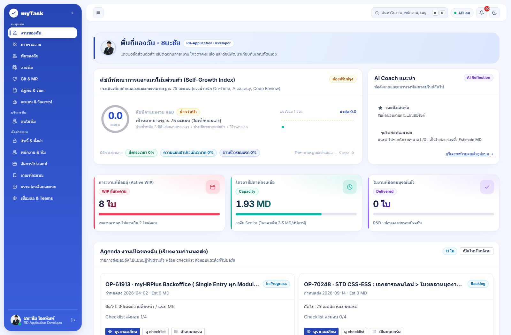

### 3. ค็อกพิทของฉัน (`/me/cockpit`)
- **สิทธิ์:** Member / Lead / Admin
- **การใช้งาน:** มุมมอง Bento Grid ส่วนตัวแบบเต็มจอ สรุป 4 ดัชนีหลัก, กราฟภาระงานเทียบแนวโน้ม OLS, DoD Donut และเรดาร์แจ้งเตือนงานเสี่ยงของตัวเอง

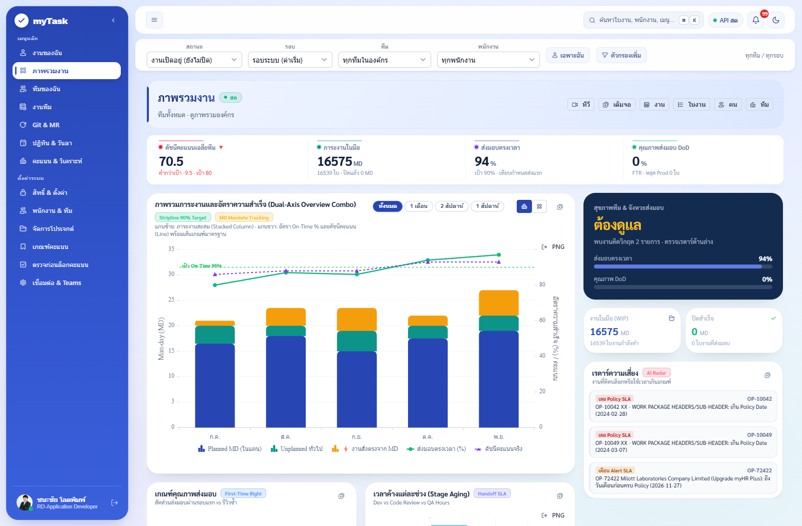

---

## ส่วนที่ 3: ภาพรวม & ทีม (Overview & People)

### 4. ค็อกพิท Bento ทีม (`/cockpit`)
- **สิทธิ์:** Lead / Admin
- **การใช้งาน:** ห้องบัญชาการผู้บริหารแบบ 3-Tier Bento Grid แสดง KPI 4 ค่าหลัก, Dual-Axis Overview Combo Chart, DoD Donut, Stage Aging และ AI Risk Radar พร้อมโหมดฉาย TV และปุ่มขยายกราฟ Deep-Dive (สลับไป `แดชบอร์ดทีม` ได้จากแท็บด้านบน)

### 5. แดชบอร์ดทีม (`/team`)
- **สิทธิ์:** Lead / Admin
- **การใช้งาน:** ภาพรวมผลงานทีมในมุมวิเคราะห์เชิงลึก แสดงกราฟแท่งดัชนีพัฒนาการเทียบเกณฑ์, สัดส่วนชนิดงาน (Donut), อัตราส่งตรงเวลา/คุณภาพ และประวัติ KPI Snapshot รายรอบ

### 6. ทีม · Workspace คน (`/workspace/people`)
- **สิทธิ์:** Lead / Admin
- **การใช้งาน (2-Stage Flow):** 
  - **ขั้นที่ 1: ตะแกรงนามบัตรพนักงาน (Employee Directory Grid)**: หน้ารวมพนักงานทั้งหมดในรูปแบบ Cards Grid สะอาดตา แสดงรูปโปรไฟล์ บทบาท สายงาน สถิติ WIP/ปิดแล้ว ดัชนีพัฒนาการ โควตาสัปดาห์ และช่องค้นหา/กรองสายงาน
  - **ขั้นที่ 2: ห้องทำงานรายบุคคล (Individual Person Workspace)**: คลิกการ์ดเพื่อเข้าสู่ Workspace ส่วนตัวของคนนั้น มี Employee Switcher Dropdown ด้านบนช่วยให้สลับคนได้ทันทีโดยไม่ต้องย้อนกลับ พร้อมปุ่ม « กลับหน้ารวมพนักงาน และแท็บสลับข้อมูล 4 มิติ (ภาพรวม, งาน, คะแนน, ทบทวนผลงาน)

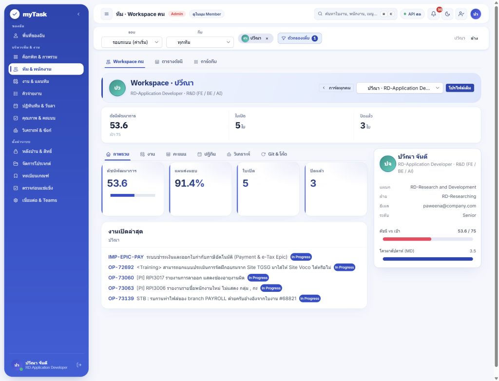

### 7. กระดานดัชนีพนักงาน (`/people`)
- **สิทธิ์:** Lead / Admin
- **การใช้งาน:** เปรียบเทียบดัชนีพัฒนาการและโควตารายบุคคลในรูปกราฟแท่งและ DataGrid (คอลัมน์ชื่อพนักงานพร้อมรูปโปรไฟล์ถูกตรึงไว้ด้านซ้าย, ส่งออก Excel/CSV และเลือกคอลัมน์ได้) คลิกชื่อเพื่อเข้าโปรไฟล์เต็มรายคน

### 8. ทีมในองค์กร — การ์ดทีม (`/org/teams`)
- **สิทธิ์:** Lead / Admin
- **การใช้งาน:** แสดงการ์ดทีมจริงทั้งหมดที่ดึงจาก myProject พร้อมรูป Lead, แถวรูปสมาชิกในทีม, จำนวนสมาชิก และสัดส่วนสายงาน คลิกการ์ดเพื่อกรองทีมนั้นข้ามทั้งระบบ

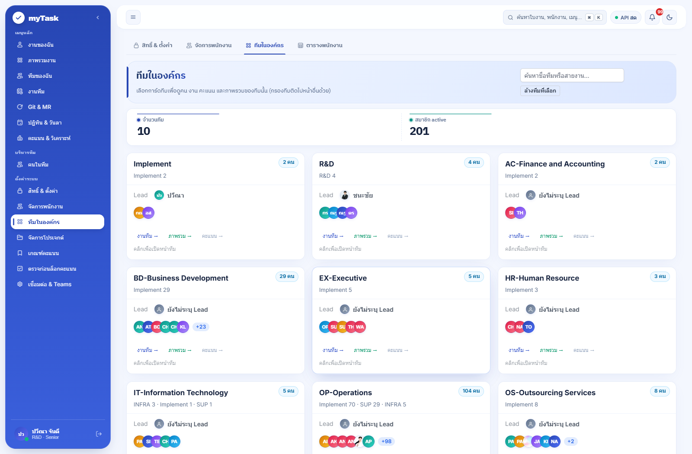

---

## ส่วนที่ 4: บริหารงาน & แผนทีม (Work, Queue & Schedule)

### 9. งาน & แผนทีม · สรุป (`/work/summary`)
- **สิทธิ์:** Lead / Admin
- **การใช้งาน:** ศูนย์รวมงานค้างตามถังวันส่ง (`เกินกำหนด`, `วันนี้`, `พรุ่งนี้`, `ในสัปดาห์`, `หลังจากนี้`), ป้ายเตือนงานแทรก MD Mandate และตัวกรองสัปดาห์แบบ Sliding Pill

### 10. บอร์ดงานทีม — Kanban (`/work/board`)
- **สิทธิ์:** Lead / Admin (Member ดูและย้ายเฉพาะงานตัวเองใน `/me/work/board`)
- **การใช้งาน:** กระดาน Kanban แบ่งสถานะงาน พร้อมสลับ Swimlane, แสดงรูปผู้รับผิดชอบบนการ์ด, ป้าย `MD-DIRECT` / `MR` / `Reopen` และคลิกเปิดแก้ไขหรือดูรายละเอียด 360° ได้ทันที

### 11. ไทม์ไลน์ทีม — Gantt (`/work/timeline`)
- **สิทธิ์:** Lead / Admin
- **การใช้งาน:** แผนผัง Gantt Chart แสดงโครงสร้างงานแม่-ลูก (`ParentID`), เปรียบเทียบ Baseline กับกำหนดส่งจริง, ปรับวันเริ่ม/จบโดยไม่ทับ `firstDueOn` และสลับมุมมองโครงงาน / มุมมองตามคนได้

### 12. รายการใบงานปฏิบัติการ (`/work/list`)
- **สิทธิ์:** Lead / Admin
- **การใช้งาน:** ตารางรายการงานแนวปฏิบัติการ แสดงโปรเจกต์ ทีม ผู้รับผิดชอบพร้อมรูป Avatar สถานะ ขนาด และกำหนดส่ง รองรับจัดกลุ่มตามโปรเจกต์ ค้นหา และส่งออก Excel

### 13. คิวจ่ายงาน (`/queue`)
- **สิทธิ์:** Lead / Admin
- **การใช้งาน:** จัดคิวใบงานใหม่ที่ยังไม่มีผู้รับ แนะนำผู้รับที่เหมาะสมตามโควตาสัปดาห์คงเหลือ และรองรับการยืนยัน Writeback ผู้รับผิดชอบกลับไปยัง myProject

### 14. ปฏิทินทีม & วันลา (`/schedule`)
- **สิทธิ์:** Lead / Admin (Member ดูเฉพาะของตัวเองใน `/me/schedule`)
- **การใช้งาน:** ปฏิทินไทม์ไลน์รายคนแบบอ่านอย่างเดียว แสดงช่วงเวลาใบงาน (สีส้ม = หลุดสัปดาห์ที่ commit) คู่กับปฏิทินย่อยด้านขวาเพื่อคลิกโฟกัสงานรายวัน

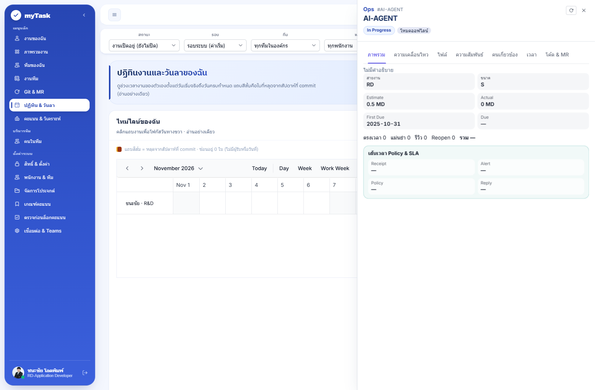

---

## ส่วนที่ 5: คุณภาพ & คะแนน (Quality & Scoring)

### 15. ตรวจรับ QA / DoD (`/quality/audit`)
- **สิทธิ์:** Lead / Admin
- **การใช้งาน:** ตรวจสอบเงื่อนไข Definition of Done (MR, Unit Test, Staging Verified) ก่อนปิดงาน พร้อมปุ่มส่งกลับแก้ (Reject to Dev) และวิเคราะห์สาเหตุ Reopen Root-Causes

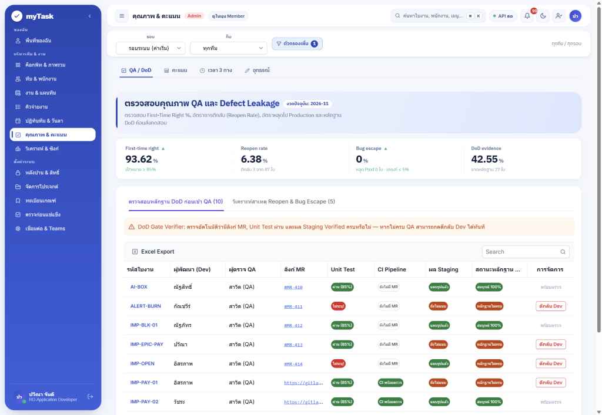

### 16. ตารางคะแนนใบงานทีม (`/quality/tickets`)
- **สิทธิ์:** Lead / Admin (Member ดูและอัปเดตเฉพาะของตัวเองใน `/me/tickets`)
- **การใช้งาน:** ตารางแจกแจงคะแนนเต็ม 100 รายใบงาน (ตรงเวลา 40 · ความแม่น 20 · รีวิว 20 · Reopen/DoD 20) พร้อมรูปผู้รับผิดชอบ, นำเข้า CSV/JSON, ซิงก์ myProject และคลิกรหัสเปิด 360° Dialog

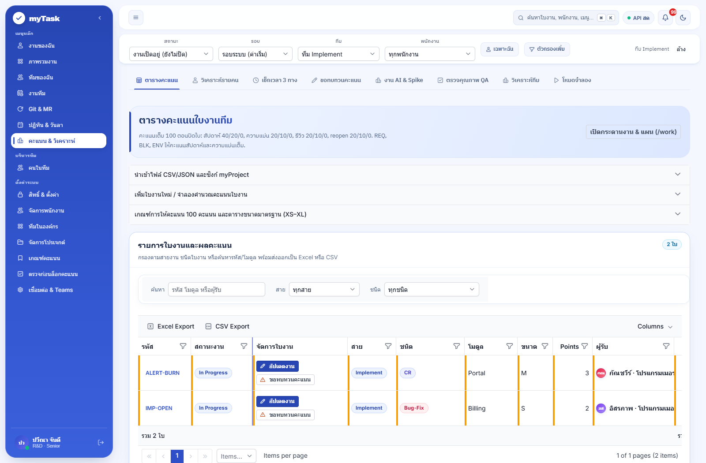

### 17. ตรวจสอบเวลา 3 ทาง (`/quality/time-audit`)
- **สิทธิ์:** Lead / Admin
- **การใช้งาน:** ตาราง 3-Way Time Matching เปรียบเทียบ Estimate MD vs เวลาที่ลงจริงใน OpenProject vs ช่วงเวลา GitLab Commit Span เพื่อจับ Outlier และความคลาดเคลื่อนของการประเมินขนาด

### 18. อุทธรณ์คะแนนทีม (`/quality/disputes`)
- **สิทธิ์:** Lead / Admin
- **การใช้งาน:** หน้าจอแบบ Split-Pane รายการคำขอทบทวนคะแนนด้านซ้าย และแผงคำนวณคะแนนจำลอง (Projected Score Diff) ด้านขวา เพื่อพิจารณาอนุมัติหรือปฏิเสธอย่างโปร่งใส

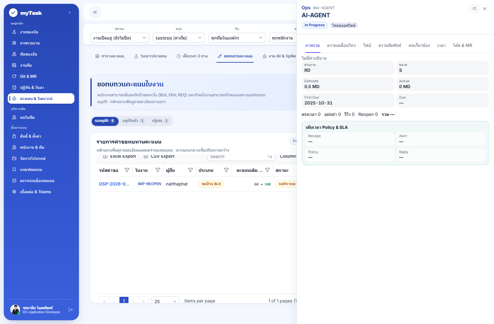

---

## ส่วนที่ 6: วิเคราะห์ & ซิงก์ (Insights & Intelligence)

### 19. ศูนย์วิเคราะห์ & Coaching (`/insights/report`)
- **สิทธิ์:** Lead / Admin
- **การใช้งาน:** ศูนย์วิเคราะห์ข้อมูลด้วย Python Analytics Engine สรุป Sync Hygiene, Z-Score Outlier, ความเสี่ยงการส่งมอบ และคำแนะนำ Coaching รายบุคคล

### 20. ซิงก์ MR / mygit (`/insights/mygit`)
- **สิทธิ์:** Lead / Admin
- **การใช้งาน:** ติดตามและซิงก์ Merge Requests จาก GitLab จับคู่กับรหัสใบงาน แสดงสถานะ CI Pipeline, รอบการรีวิว และเธรดที่ยังไม่ปิด

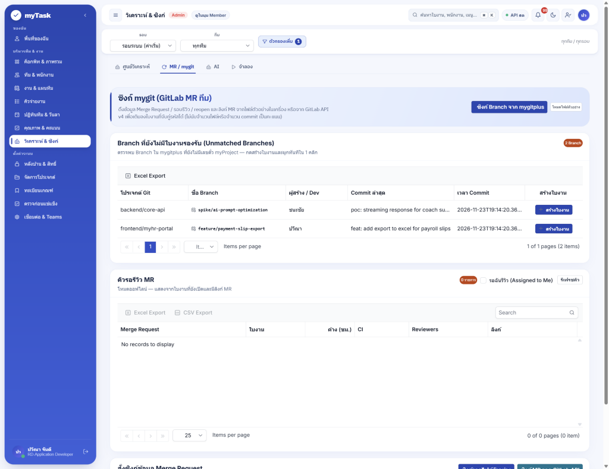

### 21. ติดตามงาน AI & Spike (`/insights/ai`)
- **สิทธิ์:** Lead / Admin
- **การใช้งาน:** ติดตามสัดส่วนและปริมาณ MD ของงานวิจัย/Spike/AI เทียบกับกรอบเป้าหมาย แสดงกราฟแท่งและตารางใบงานพร้อมผู้รับผิดชอบ (รูป Avatar) และผลรวม MD ท้ายตาราง

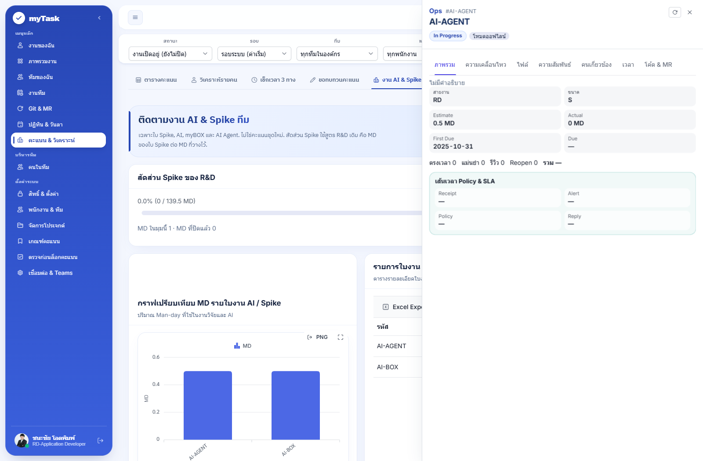

---

## ส่วนที่ 7: ตั้งค่าระบบ & ธรรมาภิบาล (Admin & Integrations)

*(แถบ Global Filter ด้านบนจะซ่อนอัตโนมัติในหน้ากลุ่มนี้เพื่อให้โฟกัสกับการตั้งค่าได้เต็มที่)*

### 22. หลังบ้าน & สิทธิ์ผู้ใช้ (`/admin`)
- **สิทธิ์:** Admin
- **การใช้งาน:** สร้าง/เปิด-ปิดรอบประเมิน (ปี พ.ศ.), ตั้งโควตาสัปดาห์ตามระดับ (Senior/Mid/Junior/FirstMonth), กฎแจ้งเตือน, น้ำหนักสูตรคะแนน, จัดการ Role Matrix และดู Audit Log

### 23. ทะเบียนเกณฑ์มาตรฐาน (`/admin/rubrics`)
- **สิทธิ์:** Admin
- **การใช้งาน:** จัดการทะเบียนสูตรและเวอร์ชันเกณฑ์การให้คะแนนสำหรับ 6 สายงาน (`IMP`, `RND`, `QA`, `UXBA`, `SUP`, `INFRA`)

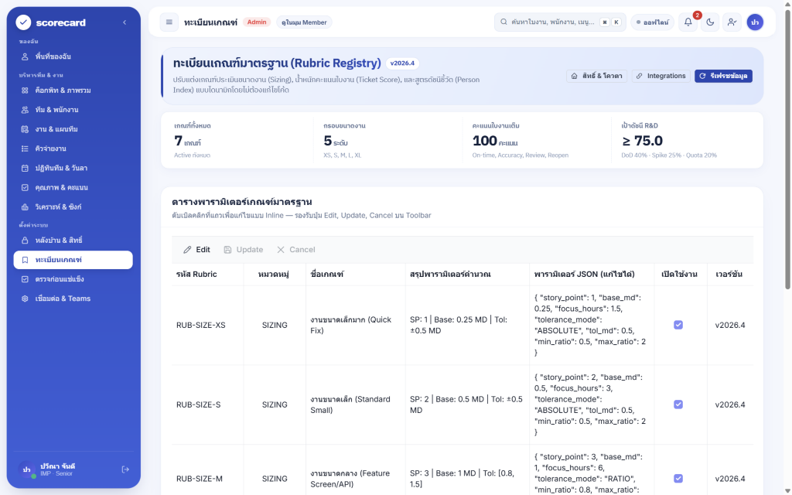

### 24. ตรวจก่อนแช่แข็งคะแนน (`/admin/snapshot-check`)
- **สิทธิ์:** Admin
- **การใช้งาน:** ตรวจสอบความพร้อมก่อนปิดรอบ (Readiness % + เช็คลิสต์ 4 ด่าน) และพรีวิวส่วนต่างดัชนีรายบุคคล (Snapshot Preview Diff) ก่อนกด Freeze คะแนน

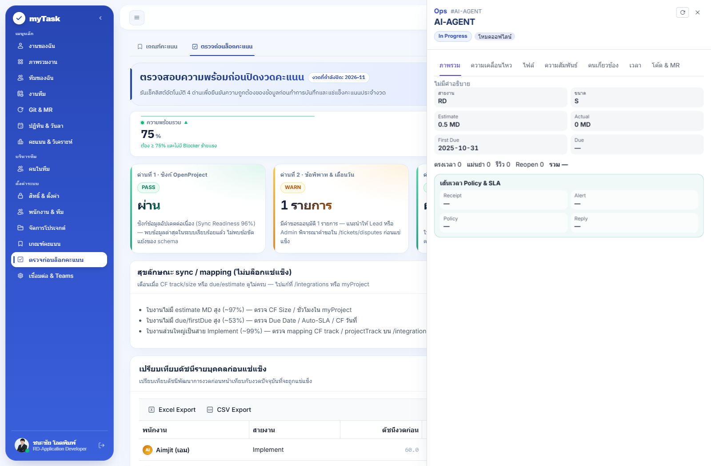

### 25. เชื่อมต่อระบบภายนอก (`/integrations`)
- **สิทธิ์:** Admin
- **การใช้งาน:** ตั้งค่าการเชื่อมต่อ OpenProject (myProject), GitLab (mygit) และ Teams พร้อมจัดการ Status/Type/Custom Field Mapping และสั่งซิงก์รายชื่อพนักงานหรือใบงาน

### 26. แจ้งเตือน Microsoft Teams (`/teams`)
- **สิทธิ์:** Admin
- **การใช้งาน:** ตั้งค่า Webhook สำหรับส่งสรุปงานค้างและแจ้งเตือนเข้าห้อง Microsoft Teams พร้อมทดสอบส่งและดูประวัติการส่งแจ้งเตือน

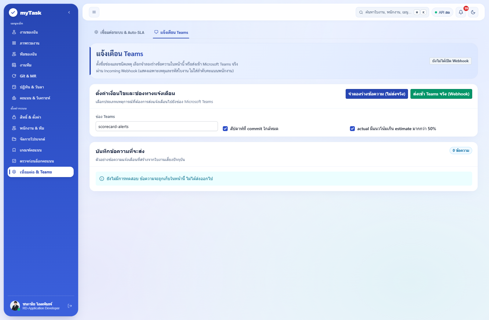

### 27. จัดการแคตตาล็อกโปรเจกต์ (`/admin/projects`)
- **สิทธิ์:** Admin
- **การทำงาน:**
  - **Smart Merge Sync**: กดปุ่ม `ซิงก์โปรเจกต์จาก myProject` เพื่อดึงข้อมูลสดจาก OpenProject API v3 โดยระบบจะผสานข้อมูลให้อัตโนมัติโดยไม่เขียนทับสถานะ `Active` หรือทีมที่เคยกำหนดไว้
  - **Active / Inactive Toggle**: สลับเปิด/ปิดการใช้งานโปรเจกต์ โปรเจกต์ที่ปิดจะถูกซ่อนออกจาก Dropdown เลือกโปรเจกต์ทั่วทั้งระบบโดยอัตโนมัติ
  - **Assigned Teams**: ผูกโปรเจกต์เข้ากับทีม/แผนกที่รับผิดชอบผ่าน MultiSelect เพื่อจำกัดขอบเขตการมองเห็นตามสิทธิ์
  - **WIP Aggregation**: แสดงยอดใบงานคงค้าง (`activeTicketsCount`) สดจากฐานข้อมูล
  - **Action Link**: ปุ่ม `แดชบอร์ด 📊` และชื่อโปรเจกต์แบบคลิกได้ นำทางตรงสู่หน้าจอรายละเอียดโปรเจกต์เชิงลึก
- **การแสดงผล:**
  - ตาราง Syncfusion DataGrid พร้อมคอลัมน์รหัส, ชื่อโปรเจกต์ (ลิงก์สีน้ำเงิน), Identifier, สวิตช์ Active, แท็กทีมที่รับผิดชอบ, ตัวเลขตั๋ว WIP แบบ Tabular Nums, และปุ่มการจัดการ

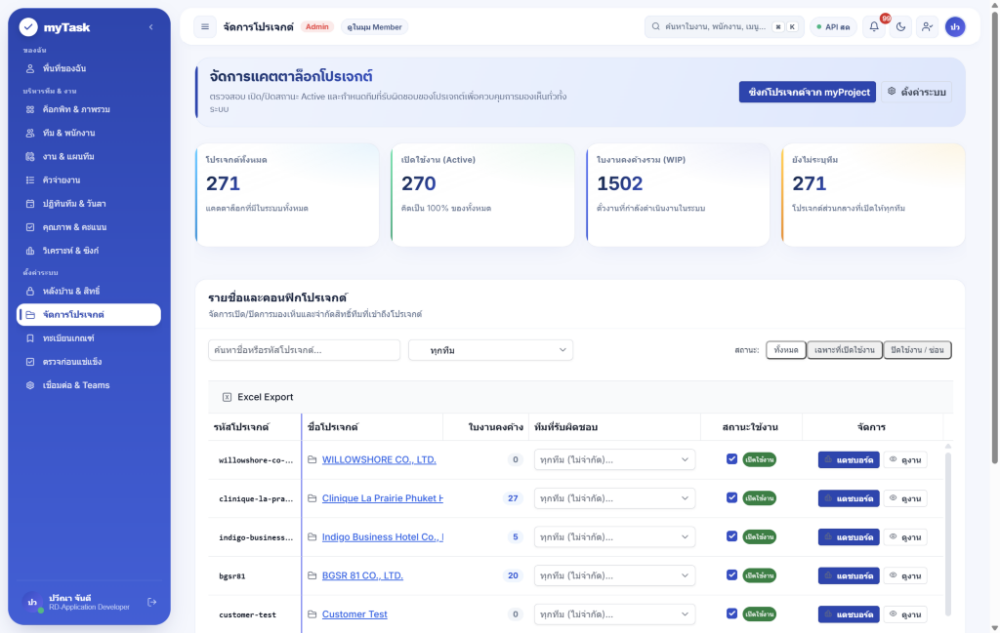

---

## ส่วนที่ 8: ศูนย์ข้อมูลโปรเจกต์ & การกำกับดูแล Git (Project & Git Governance)

### 28. ศูนย์ข้อมูลรายละเอียดโปรเจกต์ & แดชบอร์ดสุขภาพ (`/org/projects/:id`)
- **สิทธิ์:** Lead / Admin
- **การทำงาน (4 แท็บเจาะลึกรอบด้าน):**
  - **แท็บ 1: ภาพรวม & สุขภาพ (Overview & Health)**:
    - **Hero KPI Strip**: ตรวจสอบ % ความคืบหน้ารวม, ประมาณการเทียบใช้จริง (Est. vs Act. Spent MD), ใบงาน WIP คงค้าง, และงานติดขัด/ข้อบกพร่อง
    - **Man-day Progress & Effort Breakdown**: แถบความคืบหน้า Man-day แสดงสัดส่วน Actual Spent MD ต่อ Total Estimate MD
    - **Stage Distribution**: กราฟแท่งแจกแจงสถานะงาน 6 ขั้นตอน (รอดำเนินการ, กำลังทำ, รอทดสอบ, กำลังทดสอบ, เสร็จสิ้น, เปิดใหม่)
    - **Track Breakdown**: สัดส่วนภาระงานแยก 6 สายงาน (`IMP/RND/QA/UXBA/SUP/INFRA`)
    - **Risk & Blocker Watchlist**: ตารางเฝ้าระวังงานติดขัด (`blocker = true`) หรืองานค้างนานเกิน 5 วัน (`delayedAgingDays > 5`) พร้อมปุ่มเปิดดูรายละเอียดใบงาน 360°
  - **แท็บ 2: ใบงานในโปรเจกต์ (Work Packages)**:
    - ตาราง Syncfusion DataGrid รายการใบงานทั้งหมดในโปรเจกต์ แสดงรหัสตั๋ว, หัวข้อใบงาน, สายงาน, สถานะ, ผู้รับผิดชอบ (พร้อมรูป Avatar), Est. MD, Act. MD, กำหนดส่ง
    - คลิกที่รหัสตั๋วเปิดแถบ **Ticket 360° Drawer** ทางขวาเพื่อแก้ไขแผนและฟิลด์ส่งมอบได้ทันที
  - **แท็บ 3: Git & กิ่งโค้ด (Git & Repositories Governance)**:
    - **ผูก Git Repositories**: เลือก Repositories ใน mygitplus ที่เกี่ยวข้องกับโปรเจกต์นี้ผ่าน Syncfusion MultiSelect (`app-sf-multiselect`) แล้วกดบันทึก
    - **CI/CD Pipeline Health**: แสดงการ์ดสถานะ Pipeline ล่าสุดของแต่ละ Repository (Success, Running, Failed)
    - **Active Branches**: รายการกิ่งโค้ดทั้งหมด โดยระบุกิ่งที่ผูกกับใบงานแล้ว และกิ่งที่ยังไม่มีใบงานรองรับ พร้อมปุ่ม `+ สร้างใบงาน` แบบ 1-Click เปิด Smart Pre-filled Modal
  - **แท็บ 4: ทีม & บุคลากร (Teams & Allocations)**:
    - แสดงทีมที่ได้รับมอบหมาย และสรุปรายชื่อพนักงานที่มีใบงานในโปรเจกต์นี้พร้อมภาระงานรวม
- **การแสดงผล:**
  - หัวแบนเนอร์ Hero Band สีฟ้าไล่เฉด MyHR Royal Blue พร้อมสถานะ `Active`, ปุ่ม `รีเฟรช` และลิงก์ย้อนกลับ `< แคตตาล็อก`
  - Bento Grid Layout จัดวางการ์ด KPI, Progress Bar, และ DataGrid อย่างเป็นสัดส่วน รองรับทั้ง Light Theme และ Dark Theme

