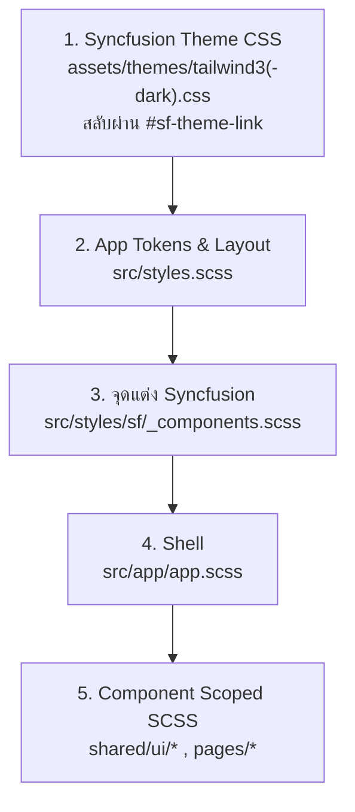
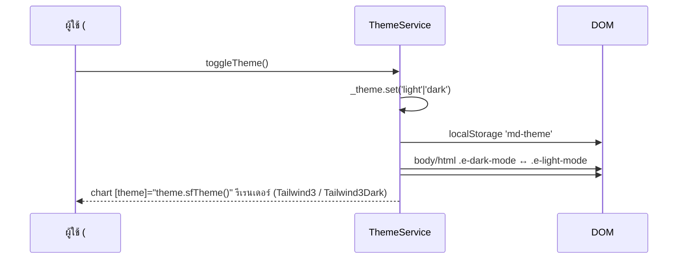
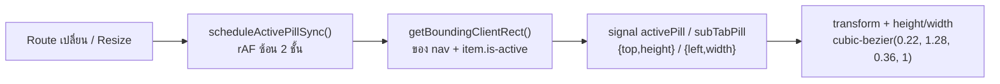

# Design System — Man-day Scorecard

สรุปสไตล์ เทมเพลต คอมโพเนนต์ ลูกเล่น และอนิเมชันของโปรเจกต์ (Angular 22 + Syncfusion Tailwind 3 + Tailwind utilities)

> อ้างอิงไฟล์หลัก: [styles.scss](../src/styles.scss) · [app.scss](../src/app/app.scss) · [sf/_components.scss](../src/styles/sf/_components.scss) · [tailwind.config.js](../tailwind.config.js) · [theme.service.ts](../src/app/core/theme.service.ts) · [shared/ui](../src/app/shared/ui/index.ts)

---

## 1. แนวคิดการออกแบบ

| หัวข้อ | แนวทาง |
|---|---|
| สไตล์รวม | **Modern Minimal SaaS** (แนว Linear / Tasklyn) + สีองค์กร **MyHR Royal Blue** |
| ธีม | **Dual Theme แบบ zero-reload** — Dark (ค่าเริ่ม, Royal Navy) / Light (ฟ้าขาวสะอาด) |
| ฐานคอมโพเนนต์ | Syncfusion ก่อน → แต่งเฉพาะจุดผ่าน wrapper ของแอป (ไม่ทับ `.e-card`/`.e-btn` ทั้งโปรเจกต์) |
| การเคลื่อนไหว | Enter animation สั้น (0.18–0.48s) + spring micro-interaction + เคารพ `prefers-reduced-motion` |
| Angular | Signals / `computed` / `@if` `@for` · **OnPush ทุก component** · คง Zone เพราะ Syncfusion |

### ลำดับชั้นสไตล์ (Style Layers)



---

## 2. Design Tokens

### 2.1 สี

| Token | Dark | Light | ใช้กับ |
|---|---|---|---|
| `--primary` | `#2e4fc8` | `#2e4fc8` | ปุ่มหลัก, accent |
| `--primary-hover` | `#2443b0` | `#2443b0` | hover ปุ่ม |
| `--primary-bright` | `#5f7ce3` | `#4c68e5` | ลิงก์, ค่าเน้น |
| `--ai-accent` | `#7465e8` | `#7465e8` | ฟีเจอร์ AI |
| `--good` / `--bad` / `--copper` | `#10b981` / `#f43f5e` / `#f59e0b` | เหมือนกัน | สถานะดี / เสีย / เตือน |
| `--ink` | `#edf3ff` | `#142b50` | ตัวอักษรหลัก |
| `--muted` | `#a4b2c8` | `#71819a` | ข้อความรอง |
| `--paper` | `#0b1120` | `#f4f7fe` (body) | พื้นหลังหน้า |
| `--surface` / `--card` | `#131f37` / rgba 0.78 | `#ffffff` | การ์ด |
| `--line` | rgba(48,67,93,.75) | `#e5ecf5` | เส้นขอบ |

**Tailwind palette** (`tailwind.config.js`): `primary-50 … primary-950` (`#eef2fd` → `#0b1538`, DEFAULT `#2e4fc8`) + `navy`, `royal`, `accent`, `good`, `bad`, `copper` · `darkMode: ['selector', '.e-dark-mode']` · `preflight: false` (กันชน Syncfusion)

**Royal Blue ของแบรนด์**: `#2746b3` → `#3154cc` → `#3b60dc` (Sidebar Light, Active pill, แถบ accent)

### 2.2 ตัวอักษร

- ฟอนต์: `'IBM Plex Sans Thai', 'Montserrat', Sarabun, 'Leelawadee UI', Tahoma, sans-serif`
- `h2` 28px / 700 / `letter-spacing: -0.02em` + **gradient text** (`#fff → #bac8f6 → #5f7ce3`)
- `h3` 18px / 700 + แถบ accent ไล่เฉดแนวตั้งด้านหน้า (`::before` 4×18px)
- `.kpi-value` 38px (มือถือ 32px) gradient text · ตัวเลข KPI ใช้ `font-variant-numeric: tabular-nums`

### 2.3 Easing

| ชื่อ | ค่า | ใช้กับ |
|---|---|---|
| `--ease-out-expo` | `cubic-bezier(0.16, 1, 0.3, 1)` | page/card enter, dropdown, sidebar |
| `--ease-spring` | `cubic-bezier(0.34, 1.56, 0.64, 1)` | micro-interaction (hover scale, badge, ปุ่มไอคอน) |
| Pill spring | `cubic-bezier(0.22, 1.28, 0.36, 1)` | Sliding active pill (Sidebar / Sub-nav) |
| KPI enter | `cubic-bezier(0.22, 1, 0.36, 1)` | การ์ด KPI, ไอคอน pop |

### 2.4 มุมโค้ง / เงา / ระยะ

- มุมโค้ง: การ์ด 14–16px · nested 12px · ปุ่ม/เมนู 8–11px · ชิป `999px`
- เงา Light: ฟ้านุ่ม `rgba(39, 70, 179, 0.07–0.24)` · Dark: `rgba(2, 6, 23, 0.45–0.55)`
- `.page` gap `1rem`, `max-width: 1420px` · grid gap 16px

---

## 3. ระบบธีม (Light / Dark)



- ลำดับค่าเริ่ม: `?theme=` ใน URL → `localStorage('md-theme')` → `dark` · มี inline script ใน `index.html` กัน FOUC
- Signals ที่ให้คอมโพเนนต์ใช้: `isDark()`, `sfTheme()`, `progressTrack()`, `progressFill()`
- **Scoped SCSS**: ใช้ `:host-context(body.e-light-mode)` + override CSS variables (ห้ามเขียน `body.e-light-mode .card` ใน component)
- รูปแบบมาตรฐาน: ประกาศ token ชุด Dark ที่ `:host` → override เฉพาะค่าใน Light (ดูตัวอย่าง [hero-band.scss](../src/app/shared/ui/hero-band/hero-band.scss#L6-L46))

| ส่วน | Dark | Light |
|---|---|---|
| Sidebar | `#0b1437 → #132158 → #1a2d75` | `#2746b3 → #3154cc → #3b60dc` |
| Active menu | ขาวโปร่ง 18% | ขาวทึบ ตัวอักษร `#2746b3` |
| AppBar | `rgba(11,20,55,.92)` | `#ffffff` |
| Hero banner | Navy gradient | `#eff4ff → #dce7ff` |
| พื้นหลังหน้า | radial-gradient 3 จุด (น้ำเงิน/ม่วง/เขียว) บน `#0b1120` | `#f4f7fe` |

---

## 4. โครง Shell / Layout

```
┌──────────┬──────────────────────────────────────────┐
│ Sidebar  │ AppBar 56px (สถานะระบบ · ผู้ใช้ · 🔔 · ธีม) │
│ 244/64px ├──────────────────────────────────────────┤
│ Workspace│ Sub-Nav Tab Bar (sliding pill)           │
│ Switcher ├──────────────────────────────────────────┤
│ Search   │ .shell-main                               │
│ 4 Pillars│   app-page-head  →  KPI  →  section-cards │
└──────────┴──────────────────────────────────────────┘
```

- **Sidebar 4 หมวดหลัก** (`visibleRail()`) + ป้ายนับหน้าย่อย + Workspace Switcher (งานของฉัน / บริหารทีม / แอดมิน) + ช่องค้นหาเมนู
- ความกว้าง `244px` / ยุบ `64px` — **ต้องตรงกัน** ใน `app.scss` และ `@media (min-width: 801px)` ใน `styles.scss`
- Desktop ≥ 801px: `position: sticky; height: 100vh` · Mobile ≤ 800px: `position: fixed; z-index: 1200` + slide `translateX(-100%)`
- `.app-frame` เปลี่ยน `grid-template-columns` แบบ animate (0.24s expo) ตอนพับ Sidebar
- Toast `ejs-toast` มุม **ล่างขวา** เสมอ ผ่าน `ShellNotice` (typed: success/error/info/warning)

### Breakpoints

| ช่วง | ใช้ทำอะไร |
|---|---|
| ≤ 640px | มือถือ: dialog `calc(100vw - 16px)`, ปุ่มสัมผัส ≥ 36px, ปลดตรึงคอลัมน์ |
| 641–1024px | แท็บเล็ต: KPI 2 คอลัมน์, ตรึง 1 คอลัมน์ |
| ≤ 800 / ≥ 801px | สลับโหมด Sidebar fixed/sticky |
| ≥ 1025px | Desktop: KPI 4 คอลัมน์, ตรึง 2 คอลัมน์ |
| ≥ 1200 × 850px | Cockpit ล็อก `100vh` |

---

## 5. Shared UI Components (`src/app/shared/ui`)

import จาก barrel เดียว: `import { ... } from '../../shared/ui';`

| Component | Selector | Inputs สำคัญ | หมายเหตุ |
|---|---|---|---|
| **PageHead** | `app-page-head` | `title`, `description`, `breadcrumb`, `periodBadge`, `badge`, `live`, `metrics` + slot `[actions]` | ห่อ `app-hero-band` |
| **HeroBand** | `app-hero-band` | `title`, `subtitle`, `badge`, `live`, `note`, `metrics: HeroBandMetric[]` | แบนเนอร์ + แถบ accent 4px + **Unified KPI Strip** |
| **SectionCard** | `app-section-card` | `title`, `subtitle`, `badge`, `badgeTone`, `variant: 'panel' \| 'nested'`, `showHead` + slot `[actions]` | เรนเดอร์ `e-card.section-card` — แผงมาตรฐานทุกหน้า |
| **KpiStat** | `app-kpi-stat` | `title`, `value`, `hint`, `badge`, `iconCss`, `progress`, `accent`, `layout`, `trendValue/Direction/Label`, `sparklineData/Type` | `e-card` + `ejs-progressbar` + `ejs-sparkline` |
| **StatusBadge** | `app-status-badge` | `label` + `tone` **หรือ** `value` + `toneMap`, `pill` | ป้าย `e-badge-*` |
| **FormField** | `app-form-field` | `label`, `hint`, `variant: 'field' \| 'filter'` | ห่อ label + control |
| **FlashMessages** | `app-flash-messages` | `success`, `error`, `info`, `warning` | `ejs-message` |
| **FilterChips** | `app-filter-chips` | `options: {id,label,count?}[]`, `value` → `(valueChange)` | ชิป active = `e-info`, อื่น = `e-outline` |
| **ConfirmDialog** | `app-confirm-dialog` | `header`, `message`, `confirmLabel`, `confirmCssClass`, `width` → `(confirmed)` `(cancelled)` · เมธอด `open()` | `ejs-dialog` animation **Fade** เท่านั้น |
| **LoadingSkeleton** | `app-loading-skeleton` | `variant: 'form' \| 'table' \| 'cards'`, `rows` (≤8), `shimmerEffect: Wave/Pulse/Fade` | `ejs-skeleton` |

### Tone Maps ([badge.ts](../src/app/shared/ui/badge.ts))

`BadgeTone = info | success | warning | danger | primary | secondary`

| Map | ตัวอย่าง |
|---|---|
| `workflowStatusToneMap` | Backlog=secondary · In Progress=primary · Code Review=warning · Ready for QA/In QA=info · Reopened/Blocked=danger · Done=success |
| `planToneMap`, `weekToneMap`, `trackToneMap` | ในแผน/นอกแผน, ตรงสัปดาห์/เลื่อน, Implement/R&D |
| `yesNoToneMap`, `blockerToneMap`, `closedToneMap`, `dodToneMap`, `unplannedYesNoToneMap` | ใช่/ไม่ ในบริบทต่างกัน |
| ฟังก์ชัน | `toneForWeekLabel()`, `toneForAlertLabel()`, `resolveBadgeTone()`, `badgeToneClass()` |

### KPI Stat — ตัวเลือก

- `accent`: `default` (น้ำเงิน) · `success` · `warning` · `danger` · `info` → เปลี่ยนสีแถบซ้าย, วงแหวนไอคอน, สี sparkline
- `layout`: `stack` · `icon-start` · `icon-end`
- `trendDirection: 'up'` → sparkline เขียว `#34d399` · `'down'` → แดง `#fb7185`
- รีเฟรชขนาดชาร์ตอัตโนมัติด้วย `ResizeObserver` + `requestAnimationFrame` + retry 80ms

---

## 6. เทมเพลตหน้า (Page Templates)

### 6.1 หน้ามาตรฐาน

```html
<section class="page">
  <app-page-head
    title="ภาพรวมทีม"
    description="สรุปภาระงานและคุณภาพรายสัปดาห์"
    periodBadge="พ.ย. 2026"
    [live]="true" badge="LIVE"
    [metrics]="heroMetrics()">
    <button actions ejs-button cssClass="e-primary">ส่งออก</button>
  </app-page-head>

  <app-flash-messages [error]="error()" />

  <div class="kpi-grid-4">
    <app-kpi-stat title="On-time" [value]="onTime()" accent="success"
                  layout="icon-end" iconCss="e-timeline-today"
                  [progress]="onTimePct()" [sparklineData]="trend()" trendDirection="up" />
    <!-- ... 3 การ์ด -->
  </div>

  <div class="grid grid-cols-1 lg:grid-cols-2 gap-4">
    <app-section-card title="Workload" subtitle="รายคน" badge="สัปดาห์นี้">
      <button actions ejs-button cssClass="e-outline e-small">⛶</button>
      <ejs-chart [theme]="theme.sfTheme()" ...></ejs-chart>
    </app-section-card>
    <app-section-card title="DoD Gate">...</app-section-card>
  </div>
</section>
```

### 6.2 Grid / Layout Utility

| คลาส | พฤติกรรม |
|---|---|
| `.kpi-grid-4` | 4 → 2 (≤1023px) → 1 (≤639px) · **ห้ามใช้ auto-fit** (กัน wrap 3+1) |
| `.card-grid-2` | `auto-fit, minmax(min(100%, 420px), 1fr)` |
| `.card-grid-3` | `auto-fit, minmax(min(100%, 300px), 1fr)` |
| `grid grid-cols-1 lg:grid-cols-2 gap-4` | แดชบอร์ดกราฟ (ใช้แทน `ejs-dashboardlayout`) |
| `.form-grid`, `.field`, `.filter` | ฟอร์ม — จำกัดความกว้าง input เฉพาะในนี้ |
| `.page-toolbar`, `.work-hub-tabs` | แถบเครื่องมือ glass blur |

### 6.3 รูปแบบเฉพาะทาง

| รูปแบบ | ที่ใช้ | จุดสำคัญ |
|---|---|---|
| **Bento Cockpit 3-Tier** | `/cockpit`, `/me/cockpit` | Tier 1 KPI ตัวใหญ่ · Tier 2 Combo dual-axis 60:40 · Tier 3 Donut/Stacked/Radar |
| **TV Presentation Mode** | Cockpit | `isTvMode` signal → `.is-tv-mode` ซ่อน AppBar/Sidebar, ขยายฟอนต์ (title 28px, value 34px) |
| **Maximize Deep-Dive** | Cockpit | ปุ่ม `⛶` → `ejs-dialog` + `@switch (maximizedCard())` + ตาราง breakdown |
| **Splitter List/Detail** | `/tickets/disputes` | `ejs-splitter` ซ้ายตาราง ขวาแผงคำนวณ |
| **Right Column Detail** | `/schedule` | ปฏิทินย่อย + รายวันด้านขวา (ไม่ใช้ sidebar drawer ทับ) |
| **Card Reveal** | `/me` | `.agenda-reveal` แผงเลื่อนขึ้นทับการ์ด (opacity + translateY 8px) |
| **Delivery Timeline** | Board dialog | `.delivery-timeline__card[data-tone=done/current/warning/pending]` |
| **Kanban Pipeline** | `/work/board` | `.e-kanban.pipeline-board` คอลัมน์ 185px, cursor grab/grabbing |

### 6.4 DataGrid Standard

- ใช้ `FreezeService` + `ViewportService`: Desktop ตรึง 2 / Tablet 1 / Mobile 0
- คอลัมน์ตรึงพื้นทึบ: Dark `#0f172a` (hover `#1e293b`) · Light `#ffffff` (hover `#f0f4fd`)
- เซลล์: badge สถานะ · `.grid-index-cell` (ค่า + progress ≤140px) · แถวเตือน `.alert-row` (เส้นซ้าย copper) · `.reference-row`
- บริการเสริม: `ColumnChooserService`, `ExcelExportService`, `ResizeService`, `AggregateService`
- เพิ่มคอลัมน์บน grid ที่ `enablePersistence` → เปลี่ยน `id` (เช่น `-v2`)

### 6.5 Chart Standard

- `[theme]="theme.sfTheme()"` ทุกชาร์ต
- แท่ง: `cornerRadius: { topLeft: 8, topRight: 8 }` · gridline ประ `dashArray: '4,4'`
- Dual-axis: `axes: [{ name: 'yAxis2', opposedPosition: true }]` + `stripLines` เส้นประ Target (เช่น 90% On-time, 80% Pareto)
- Radar 6 มิติขึ้นไป: คอนเทนเนอร์กว้าง ≥ 400–500px
- Donut `centerLabel` ผูก `effect()` กับ `theme.isDark()`
- Selector ปลอดภัย: `ejs-chart, .e-control.e-chart` (ห้าม `.e-chart` โดดๆ — ชนไอคอน)

---

## 7. อนิเมชัน (Animation Catalog)

### 7.1 Enter Animations

| Keyframe | ไฟล์ | การเคลื่อนไหว | เวลา | ใช้กับ |
|---|---|---|---|---|
| `pageFadeUp` | styles.scss | fade + `translateY(6px→0)` | 0.28–0.42s expo | `.page`, router view |
| `cardReveal` | styles.scss | fade + `translateY(8px→0)` | 0.3s expo | `.e-card.section-card` |
| `kpi-stat-enter` | kpi-stat-card.scss | fade + `translateY(10px) scale(.985)` | 0.48s | `app-kpi-stat` |
| `kpi-stat-value-in` | kpi-stat-card.scss | fade + `translateY(6px)` | 0.42s | ตัวเลข KPI |
| `kpi-stat-icon-pop` | kpi-stat-card.scss | `scale .82 → 1.06 → 1` | 0.55s | ไอคอน KPI |
| `kpiStripEnter` | hero-band.scss | fade + `translateY(6px)` delay 55ms | 0.34s | KPI Strip |
| `navGroupFade` | app.scss | fade + `translateY(5px)` | 0.28s | กลุ่มเมนู Sidebar |
| `dropdownPop` | app.scss | `translateY(-5px) scale(.97)` | 0.18s | Workspace Switcher menu |
| `iconPop` | app.scss | `scale(.82) rotate(-18deg)` → ปกติ | 0.26s spring | SVG ปุ่ม AppBar (เช่นสลับธีม) |
| `dialogPopIn` | styles.scss | `scale(.94) translateY(8px)` | — | สำรอง (ไม่ใช้บน `.e-dialog`) |

### 7.2 Stagger (เข้าทีละใบ)

| กลุ่ม | ดีเลย์ |
|---|---|
| `.kpi-grid-4 > app-kpi-stat` | 20 / 80 / 140 / 200 / 260 / 320 ms |
| `.grid > app-section-card` | 20 / 65 / 110 / 155 / 190 ms |
| `.saas-nav__group` | +35ms ต่อกลุ่ม (สูงสุด 140ms) |

### 7.3 Loop / Ambient

| Keyframe | เอฟเฟกต์ | ใช้กับ |
|---|---|---|
| `heroBandPulse` / `pulseGlow` | จุดกระพริบ scale .85 + opacity (1.8s) | ป้าย **LIVE** |
| `kpi-stat-accent-glow` | แถบสีซ้ายสว่างขึ้น-ลง (3.6s) | แถบ accent ของ KPI |
| `pulseRing` | วงแหวนส้มขยาย 6px | จุดเตือน |
| `floatSlow` | ลอยขึ้นลง 2px | ตกแต่ง |

### 7.4 Micro-interactions (Hover / Active)

| องค์ประกอบ | เอฟเฟกต์ |
|---|---|
| `.e-badge` (ไม่ใช่ notification) | hover `scale(1.04)` spring |
| KPI card | hover: ค่า `scale(1.03)`, ไอคอน `scale(1.08) rotate(-3deg)`, วงแหวนสี 4px ตาม accent, ขอบ/เงาฟ้าเข้ม |
| Hero KPI metric | hover: พื้นฟ้าจาง + เส้นบน `scaleX(.4→1)` + ค่า `scale(1.035)` เปลี่ยนสี accent + ลูกศร ▲▼ เด้ง |
| Sidebar item | hover ไอคอน `translateX(2px) scale(1.08)` |
| ปุ่มไอคอน AppBar | hover `scale(1.06)` · active `scale(0.92)` |
| Sub-nav tab / Switcher | active `scale(0.96)` / `scale(0.985)` · caret หมุน 180° |
| `.person-link` | hover glow `text-shadow` ฟ้า |
| Section card / page-head | hover เปลี่ยนสีขอบ + เงา (ไม่มี transform) |
| Input ใน `.field/.filter` | focus ring `0 0 0 3px rgba(primary, .22)` |

### 7.5 Sliding Active Pill (ลายเซ็นของแอป)

แถบไฮไลต์ที่ "ไหล" ไปหาเมนูที่เลือก — ทั้ง Sidebar (แนวตั้ง) และ Sub-Nav (แนวนอน)



- โค้ด: [app.ts](../src/app/app.ts#L535-L593) · สไตล์: `.saas-nav__active-pill`, `.subnav-tabs__pill` ใน [app.scss](../src/app/app.scss)
- `ResizeObserver` บน nav + tab bar · `will-change: transform` · ซ่อนด้วย `opacity` เมื่อไม่มี active

### 7.6 Chart Resize Protection

`ResizeObserver` + debounce 150ms → `window.dispatchEvent(new Event('resize'))` ให้ชาร์ต Syncfusion คำนวณขนาดใหม่เมื่อพับ/ขยาย Sidebar (Cockpit, Team Dashboard, Work Summary, Schedule, KPI Stat)

### 7.7 Accessibility

```scss
@media (prefers-reduced-motion: reduce) {
  *, *::before, *::after {
    animation-duration: 0.01ms !important;
    transition-duration: 0.01ms !important;
    scroll-behavior: auto !important;
  }
}
```

---

## 8. ลูกเล่นเชิงภาพอื่นๆ

- **Glassmorphism**: `backdrop-filter: blur(10–12px)` บน page-head, toolbar, sub-nav, AppBar
- **Gradient text**: `h2`, `.kpi-value`
- **Ambient background**: radial-gradient 3 จุดแบบ `background-attachment: fixed` (Dark)
- **Accent bars**: แถบ 4px ซ้าย hero banner · 3px ซ้าย KPI card · 4×18px หน้า `h3`
- **Dashed dividers**: เส้นประแนวตั้งคั่น metric ใน KPI Strip
- **Container queries**: Hero band ใช้ `container-type: inline-size` → strip 2 คอลัมน์เมื่อกว้าง ≤ 640px
- **Status pulse dot**: AppBar `.is-api` เขียว / `.is-mock` ส้ม
- **Notification badge**: `e-badge-notification e-badge-overlap` บนกระดิ่ง → เปิด `#alertDialog`
- **Avatar**: gradient `#2e4fc8 → #6366f1` วงกลม / `.avatar-badge` มุม 12px

---

## 9. กฎห้าม (Do / Don't)

| ✅ ทำ | ❌ ห้าม |
|---|---|
| ใช้ `app-section-card` สำหรับแผงใหม่ | ห่อด้วย `rounded-xl border bg-white dark:bg-slate-900 shadow-sm` |
| `[value]="x()"` + `(change)` กับ Syncfusion | `[(value)]` กับ class field |
| `ejs-dialog` animation `Fade` | `transform` บน `.e-dialog`, `.e-btn`, `.e-card:hover`, `.e-dashboardlayout .e-panel:hover` |
| จำกัดความกว้าง input ใน `.field/.filter/.form-grid` | `button {}` หรือ `.e-control-wrapper { width:100% }` แบบกว้าง |
| แต่ง Syncfusion เพิ่มใน `sf/_components.scss` ตามหมวด | ทับ `.e-card` ทั้งโปรเจกต์ |
| CSS Grid + section-card บนแดชบอร์ดกราฟ | `ejs-dashboardlayout` (การ์ดบีบ/กราฟพับ) |
| ไอคอนที่ตรวจแล้ว: `e-grid-view`, `e-timeline-today`, `e-table`, `e-columns`, `e-timeline-month` | `e-dashboard`, `e-date-time`, `e-table-1` (glyph หาย) |
| Token + override Light ใน component (ประหยัด CSS budget 28/36kB) | เขียนสไตล์ซ้ำทั้งชุดสำหรับแต่ละธีม |
| `overflow` ปล่อยตามค่าเดิมบน Gantt/Schedule | `overflow: hidden` โดยไม่จำเป็น |
