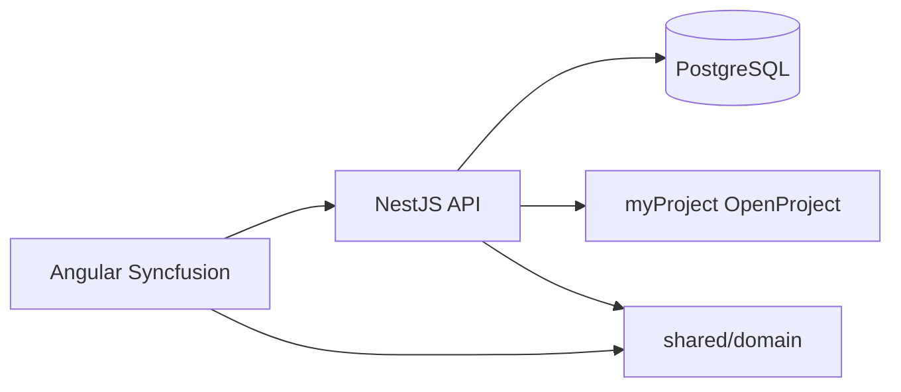

# เอกสารระบบ Man-day Scorecard

ภาพรวมสถาปัตยกรรม ขอบเขตโดเมน และจุดต่อเชื่อมหลักของโปรเจกต์  
คู่มือติดตั้ง/ใช้งาน: [คู่มือ.md](คู่มือ.md) · แผนงานต่อ: [แผนงาน.md](แผนงาน.md)

---

## เป้าหมายระบบ

ให้คะแนนใบงานด้วย **man-day** แยกสาย **Implement** / **R&D** แสดงดัชนีรายคนและทีม  
ซิงก์งานจาก **myProject (OpenProject)** อ่านเป็นหลัก ยังไม่บังคับเขียนกลับ

---

## สถาปัตยกรรม



| ชั้น | พาธ | บทบาท |
|---|---|---|
| เว็บ | `src/app/` | Angular 22.2.6 · signals + OnPush + Zone · Syncfusion Tailwind 3 Dual Theming (`darkMode` ตาม `.e-dark-mode`) · MyHR sidebar gradient · `app-kpi-stat` (trend/progress/sparkline/skeleton) / `app-section-card` (`e-card.section-card` panel|nested) · Sticky Mini-Sidebar (68px/260px) · สไตล์ 3 ชั้น: theme CSS → `styles.scss` → `src/styles/sf/` · DataGrid cell polish · Gantt ProjectView/ResourceView · AppBar แจ้งเตือนไอคอน+badge · Toast typed (`ShellNotice`) |
| API | `server/` | Auth, repos, OpenProject sync, cron, Python Analytics engine |
| โดเมนร่วม | `shared/domain/` | สูตรคะแนน, workflow, มุมมองงาน, Python Analytics — **pure ไม่พึ่ง Nest/Angular** |
| ข้อมูลตัวอย่าง | seed ใน server + `shared/seed` / mock | คน 15 · ใบงานตัวอย่าง |
| เอกสาร | `docs/` | คู่มือ, walkthrough, โหมดจำลอง, รายงาน UX/UI checklist |
| ตรวจกติกา | `scripts/verify-scores.ts` | ล็อกเลขอ้างอิง เช่น IMP-100 / RD-SPIKE = 100 |

---

## โมดูลโดเมน (`shared/domain/`)

| ไฟล์ | ใช้ทำอะไร |
|---|---|
| `models.ts` | Person, Ticket, Track, Size, workflow enums |
| `scoring.ts` | คะแนนใบ / ดัชนีคน Implement·R&D · โควตา |
| `workflow.ts` | สถานะคัมบัง, วันเริ่ม/ส่ง, กฎย้ายสถานะ |
| `capacity.ts` | แผนคิวงานใหม่ · free MD |
| `alerts.ts` | deadline / overrun |
| `people-roster.ts` | แถวรายชื่อพนักงาน |
| `person-dashboard.ts` | กราฟ/กริดโปรไฟล์รายคน |
| `work-views.ts` | Summary / Gantt / Backlog / List ของ `/work` และ `/me/work` (`assigneeId` scope) |
| `delivery-timeline.ts` | สร้างเหตุการณ์ส่งมอบสำหรับ `ejs-timeline` ใน Board Dialog |
| `mock-scenario.ts` | สถานการณ์โหมดจำลอง |
| `dashboard-charts.ts` / `kpi-meaning.ts` | กราฟทีม · คำอธิบาย KPI |
| `ticket-file.ts` | นำเข้า CSV/JSON |
| `ai-tracking.ts` | มุมมอง Spike / AI |
| `gitlab-mr.ts` | จับคู่ Merge Request จาก GitLab API กับรหัสใบงาน |
| `analytics.ts` | Python Sync & Analytics Intelligence (Sync Hygiene, Z-score Outlier, Delivery Risk Radar, Module/Variance Bottlenecks, 1-on-1 Coaching Insights) + `scripts/analytics_engine.py` |
| `multi-team.ts` | การคำนวณ Handoff SLA, Quality & Defect Audit, 3-Way Time Audit, Dispute Impact Simulation, และ Preflight Readiness Checklist สำหรับ Enterprise Multi-Team (v2.0) |

กติกาสำคัญ: **อย่าแก้สูตรคะแนนโดยไม่รัน `npm run verify`** และอย่าใส่ logic โดเมนลง UI หรือ Nest โดยตรงถ้าใช้ร่วมได้

---

## หน้าเว็บหลัก (แยกเมนูสามโซน: ของฉัน / ดูทีม / แอดมิน)

เมนู sidebar จัดเป็น 3 กลุ่มตาม `effectiveRole()`:

- **ของฉัน** (ทุกสิทธิ์): `/me` · `/me/work` · `/tickets/disputes` · `/login` · `/mockup`
- **ดูทีม** (`admin` | `lead`): แดชบอร์ดทีม, ฮับ `/work`, handoff, ตารางคะแนน, ปฏิทิน, คิว, รายชื่อ, QA audit, AI, mygit
- **แอดมิน** (`admin` เท่านั้น): analytics, time-audit, snapshot-check, rubrics, หลังบ้าน, Teams, Integrations

| Route | สิทธิ์ขั้นต่ำ | หน้าที่ |
|---|---|---|
| `/me` | ทุกสิทธิ์ | **ผลงานของฉัน**: KPI ดัชนีพัฒนา, โควตา, Self-Coaching, Agenda งานเปิด, ใบปิด |
| `/me/work/*` | ทุกสิทธิ์ | **ฮับงานของฉัน**: Summary · Timeline (อ่านอย่างเดียว) · Backlog (ใบ Backlog ที่ assign ให้ฉัน) · Board · List — ใช้ `WorkShell` เดิมกรอง `assigneeId` |
| `/login` | ทุกสิทธิ์ | **เข้าสู่ระบบ** (auth viewport แยกจาก shell) · ราก `/` redirect มาที่นี่ |
| `/analytics` | `admin` | **ศูนย์วิเคราะห์ข้อมูล (Python Analytics & Sync Intelligence Hub)** |
| `/team` | `lead`, `admin` | แดชบอร์ดทีม + KPI snapshot ย้อนหลัง (เดือน/ไตรมาส) |
| `/people` | `lead`, `admin` | รายชื่อพนักงาน (Export/Aggregates) |
| `/people/:id` | `lead`/`admin` หรือเจ้าของเอง | โปรไฟล์+กราฟ+งานรายคน |
| `/work/*` | `lead`, `admin` | ฮับบริหารงานทีม: Summary · Timeline (แก้วันได้) · Backlog คิวทีม · Board · List · Handoff |
| `/tickets` | `lead`, `admin` | ตารางคะแนนใบงาน |
| `/tickets/disputes` | ทุกสิทธิ์ (อนุมัติ: `lead`/`admin`) · member เห็นเฉพาะคำขอของตน | **ศูนย์อุทธรณ์คะแนน** |
| `/work/handoff` | `lead`, `admin` | **ส่งต่อ & SLA ข้ามทีม** |
| `/quality/audit` | `lead`, `admin` | **ตรวจสอบคุณภาพ QA** |
| `/analytics/time-audit` | `admin` | **ตรวจสอบเวลา 3 ทาง** |
| `/admin/snapshot-check` | `admin` | **ตรวจสอบก่อนแช่แข็ง** |
| `/schedule` | `lead`, `admin` | ปฏิทินทีม |
| `/queue` | `lead`, `admin` | คิวงานใหม่ |
| `/mygit` | `lead`, `admin` | ซิงก์ Merge Request |
| `/teams` | `admin` | แจ้งเตือน Teams |
| `/ai` | `lead`, `admin` | ติดตามงาน AI / Spike |
| `/integrations` | `admin` | Integrations 3 ระบบ |
| `/mockup` | ทุกสิทธิ์ | โหมดจำลองโฟลว์ใบงาน→คะแนน |
| `/admin` | `admin` | โควตา · น้ำหนักคะแนน · Role Matrix · Audit Log |
| `/admin/rubrics` | `admin` | **Rubric Registry** |

`/pipeline` redirect ไป `/work/board` (ต้องเป็น lead/admin)

---

## เซิร์ฟเวอร์

| กลุ่ม | พาธโดยประมาณ | บทบาท |
|---|---|---|
| Auth | `server/src/auth/` | GitLab OAuth / Dev login · session · role |
| Data | `server/src/data/` | people, work items, settings, sessions, kpi snapshots |
| OpenProject | `server/src/integrations/openproject/` | client · mapper · sync |
| KPI | `server/src/kpi/` · `shared/domain/kpi-snapshot.ts` | จับ/แช่แข็ง PersonScore ตามเดือน·ไตรมาส |
| API | `server/src/api/` | HTTP controllers |
| DB | `server/src/db/` | migrate · seed |

### แมป OpenProject → Ticket (สรุป)

- มาตรฐาน: Assignee, Status→workflow, Type, estimated/spent → MD, start/due/closed  
- Custom fields (ตั้งใน Integrations): Size, Track, Variance, Unplanned, Story points, Discipline, Work category, Review rounds, Blocker, DoD, Spike flags, MR, Bug cause, PoC, Week offset, First due  
- ฟิลด์ส่วนขยาย v2026.4: `baselineDue` (กำหนดส่งแรกเริ่ม), `exceptionTag` (แท็กขอยกเว้น SLA), `rdWorkTrack` (แทร็กย่อย R&D), `spikeOutcome` (ผลลัพธ์การค้นคว้า Spike)
- OpenProject Activity Comment Writeback: บันทึกข้อความ Markdown ลง `/api/v3/work_packages/:id/activities` อัตโนมัติเมื่อมีการสั่งพักงานหรือเลื่อนส่งมอบจากคำสั่ง MD Mandate
- รายละเอียดในคู่มือตารางฟิลด์ และ `DEFAULT_OPENPROJECT_MAPPING`

### AI Coach & OLS Trendline Engine (v2026.4)

- **OLS Regression Trendline**: คำนวณความชัน Least-Squares Slope ($y = mx + c$) ย้อนหลัง 6 เดือนบนหน้า `/people/:id` เพื่อตรวจจับแนวโน้มพัฒนาการเชิงสถิติ (เส้นประสีม่วง `#a855f7`) พร้อมป้ายสถานะ Slope รายเดือน
- **AI Coach 1-on-1 Dialogue (`/api/ai/coach-summary`)**: เชื่อมต่อ Google Gemini 2.5 Flash พร้อมระบบ Fallback เป็น Rule-based Synthesis ภาษาไทย วิเคราะห์เจาะลึก 4 มิติ (จุดแข็ง, จุดเฝ้าระวัง, คำถาม 1-on-1, เป้าหมาย Sprint ถัดไป) พร้อมปุ่มคำถามด่วนแนะนำบนโปรไฟล์พนักงาน

---

## สิทธิ์

| Role | สิทธิ์หลัก |
|---|---|
| `admin` | แก้ settings / mapping / จับคู่ user · ย้ายสถานะทุกขั้นรวม `Done` · แก้วันเริ่ม/ส่งบน Gantt |
| `lead` | อ่าน+ซิงก์ · assign/รับคิว (+ยืนยัน writeback) · ย้ายสถานะทุกขั้นรวม `Done` · แก้วันเริ่ม/ส่งบน Gantt |
| `member` | อ่าน+ซิงก์ · ย้ายการ์ดตัวเองบน Board ได้ถึง `Ready for QA` / `In QA` (ห้ามปิด `Done` เอง) · แก้ฟิลด์ส่งมอบ (`mrLink`, `pocResult`, `bugCause`) |

---

## โฟลว์รับมืองานสั่งตรงจาก MD (MD Mandate & Auto-Shift Workflow)

เมื่อมีงานด่วนสั่งตรงจาก MD แทรกเข้ามากลางสัปดาห์ ระบบมีกลไกคุ้มครองความเป็นธรรมของคะแนน KPI ดังนี้:

1. **การระบุงาน**: ติ๊ก `isMdDirect: true` บนการ์ดใน `/work/board` หรือกดปุ่ม `⚡ รับงานด่วน MD & เลื่อนงานเดิม` ใน `/queue` การ์ดจะแสดงป้าย `[MD-DIRECT]`
2. **Active WIP Auto-Detection**: เมื่อลากการ์ด MD เข้า `In Progress` ระบบจะตรวจจับงานค้างในมือ (`In Progress` / `Reopened`) ของน้องคนนั้นอัตโนมัติ และแสดง Dialog ให้เลือกพักงาน
3. **Auto-Pause & Shift firstDueOn**: เมื่อกดยืนยัน งานเดิมจะเปลี่ยนสถานะย่อยเป็น `[PAUSED]` และระบบจะคำนวณเลื่อนวันส่งแรก (`firstDueOn`) ออกไปตามขนาดงาน MD ด้วยฟังก์ชัน `addWorkingDays` (ข้ามวันเสาร์-อาทิตย์เสมอ) พร้อมบันทึกประวัติลง `ticket_due_shifts` และ Audit Log
4. **Scoring Protection Rules**:
   - **On-time**: งานเดิมที่ถูกพัก (`isPaused: true`) การันตีเต็ม 40 คะแนน ไม่ถูกตัดคะแนนส่งช้า
   - **Accuracy**: วันที่ถูกพัก (`pausedDays`) จะถูกนำมาหักลบออกจาก `actualMd` กลายเป็น Net Actual MD ก่อนคำนวณอัตราส่วน การันตีไม่เสียคะแนนความแม่นยำ (20 คะแนน)
   - **MD Credit**: ใบงาน MD นับเข้าโควตาผลงานเต็มจำนวน และแยกแสดงผลวิเคราะห์ MD Share (%) บน Dashboard ทีมและรายบุคคล

---

## กลไกความแม่นยำและโควตาพิเศษ (Accuracy & Review Quota)

1. **Tiered Tolerance Accuracy Engine**:
   - **XS / S ($\le 0.5$ MD)**: กรอบกว้าง $[0.5, 2.0]$ ได้เต็ม 20 คะแนน (ยอมรับความแปรปรวนสูงของงานเล็ก)
   - **M ($1.0$ MD)**: กรอบมาตรฐาน $[0.8, 1.5]$ ได้เต็ม 20 คะแนน
   - **L / XL ($\ge 2.0$ MD)**: กรอบวินัยเข้ม $[0.85, 1.3]$ ได้เต็ม 20 คะแนน
   - คำนวณ Net Actual MD โดยหักลบวันพักงาน (`pausedDays`), เวลาติดบล็อก (`blockedHours`), และเวลารอคิว QA
2. **GitLab Approvals & Peer Review Quota**:
   - ซิงก์รายชื่อผู้ตรวจโค้ด (`reviewers`) และผู้อนุมัติ (`approved_by`) ผ่าน GitLab API `/api/v4/projects/:id/merge_requests/:iid/approvals`
   - มอบเครดิตเวลาโควตา **Peer Review MD** (10–15% ของ `estimateMd`) ให้ Senior ในทีมเพื่อความเป็นธรรมในการทุ่มเทเวลาตรวจโค้ด
3. **OpenProject firstDueOn Protection**:
   - เมื่อซิงก์ข้อมูลจาก myProject/OpenProject: หาก `firstDueOn` มีค่าอยู่แล้ว ห้ามเขียนทับโดยเด็ดขาด ยกเว้นมีคำสั่งอนุมัติจากตาราง `ticket_due_shifts` สถานะ `APPROVED`

---

## การตรวจคุณภาพ

```powershell
npm run verify
npm --prefix server run test
npm run build
npm --prefix server run build
```

อ้างอิงคะแนนต้องคง: **IMP-100 total = 100**, **RD-SPIKE spikeScore = 100** (และเคสใน `verify-scores.ts`)

---

## สถานะเฟสงาน (ดูแผนงาน)

P1 ถึง P13 ทำเสร็จแล้ว ครอบคลุม Enterprise Multi-Team (25 หน้าจอ), Dual Theming (MyHR sidebar + `darkMode` ตาม `.e-dark-mode`), MD Mandate, Tiered Tolerance, Peer Review Quota, persist ข้อมูลองค์กร, ผูกสูตรกับ rubric/วันลา/เครดิตผู้ตรวจ, hardening session/`@Public`/cron, มาตรฐาน UI Syncfusion (`app-kpi-stat` / `app-section-card` = `e-card.section-card` / `e-badge` / `ejs-message`), ชั้นสไตล์จุดกลาง `src/styles/sf/`, DataGrid cell polish, และ UX polish ชุดเลือก (Gantt Resource View, Toast typed, AppBar แจ้งเตือนไอคอน, Delivery Timeline, disputes Splitter) — รายละเอียดใน [แผนงาน.md](แผนงาน.md)
