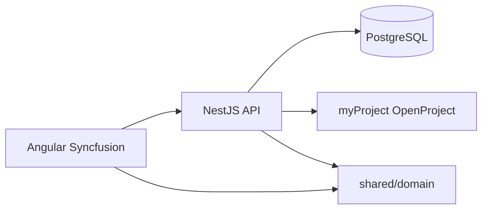

# เอกสารระบบ Man-day Scorecard

ภาพรวมสถาปัตยกรรม ขอบเขตโดเมน และจุดต่อเชื่อมหลักของโปรเจกต์  
คู่มือติดตั้ง/ใช้งาน: [คู่มือ.md](คู่มือ.md) · แผนงานต่อ: [แผนงาน.md](แผนงาน.md)

---

## เป้าหมายระบบ

ให้คะแนนใบงานด้วย **man-day** แยกสาย **Implement** / **R&D** แสดงดัชนีรายคนและทีม  
ซิงก์งานจาก **myProject (OpenProject)** อ่านเป็นหลัก ยังไม่บังคับเขียนกลับ

---

## สถาปัตยกรรม



| ชั้น | พาธ | บทบาท |
|---|---|---|
| เว็บ | `src/app/` | Angular 22.2.6 · signals + OnPush + Zone · Syncfusion Tailwind 3 Dark |
| API | `server/` | Auth, repos, OpenProject sync, cron |
| โดเมนร่วม | `shared/domain/` | สูตรคะแนน, workflow, มุมมองงาน — **pure ไม่พึ่ง Nest/Angular** |
| ข้อมูลตัวอย่าง | seed ใน server + `shared/seed` / mock | คน 15 · ใบงานตัวอย่าง |
| เอกสาร | `docs/` | คู่มือ, walkthrough, โหมดจำลอง |
| ตรวจกติกา | `scripts/verify-scores.ts` | ล็อกเลขอ้างอิง เช่น IMP-100 / RD-SPIKE = 100 |

---

## โมดูลโดเมน (`shared/domain/`)

| ไฟล์ | ใช้ทำอะไร |
|---|---|
| `models.ts` | Person, Ticket, Track, Size, workflow enums |
| `scoring.ts` | คะแนนใบ / ดัชนีคน Implement·R&D · โควตา |
| `workflow.ts` | สถานะคัมบัง, วันเริ่ม/ส่ง, กฎย้ายสถานะ |
| `capacity.ts` | แผนคิวงานใหม่ · free MD |
| `alerts.ts` | deadline / overrun |
| `people-roster.ts` | แถวรายชื่อพนักงาน |
| `person-dashboard.ts` | กราฟ/กริดโปรไฟล์รายคน |
| `work-views.ts` | Summary / Gantt / Backlog / List ของ `/work` |
| `mock-scenario.ts` | สถานการณ์โหมดจำลอง |
| `dashboard-charts.ts` / `kpi-meaning.ts` | กราฟทีม · คำอธิบาย KPI |
| `ticket-file.ts` | นำเข้า CSV/JSON |
| `ai-tracking.ts` | มุมมอง Spike / AI |
| `gitlab-mr.ts` | จับคู่ Merge Request จาก GitLab API กับรหัสใบงาน |

กติกาสำคัญ: **อย่าแก้สูตรคะแนนโดยไม่รัน `npm run verify`** และอย่าใส่ logic โดเมนลง UI หรือ Nest โดยตรงถ้าใช้ร่วมได้

---

## หน้าเว็บหลัก

| Route | หน้าที่ |
|---|---|
| `/team` | แดชบอร์ดทีม + KPI snapshot ย้อนหลัง (เดือน/ไตรมาส) |
| `/people`, `/people/:id` | รายชื่อพนักงาน (พร้อม Export/Aggregates) · โปรไฟล์+กราฟ+งาน |
| `/work/*` | ฮับบริหารงาน: Summary · Timeline (Gantt Hierarchy + Date Edit) · Backlog · Board (Swimlane + Dialog) · List |
| `/tickets` | ตารางคะแนนใบงาน (`ejs-accordion` นำเข้า/เพิ่มใบงาน · ตรึงคอลัมน์ · Export · แถวสรุปผลรวม) |
| `/schedule` | ปฏิทินทีม (Schedule) |
| `/queue` | คิวงานใหม่ (รับข้อเสนอ + Dialog ยืนยัน writeback) |
| `/mygit` | ซิงก์ Merge Request จากไฟล์ตัวอย่างหรือ GitLab API v4 |
| `/teams` | แจ้งเตือน Teams (จำลองร่างข้อความหรือยิง Incoming Webhook จริง) |
| `/ai` | ติดตามงาน AI / Spike |
| `/integrations` | แท็บตั้งค่า 3 ระบบ: OpenProject (พร้อมตัวช่วย `statusMap`), GitLab MR, Microsoft Teams |
| `/mockup` | โหมดจำลองโฟลว์ใบงาน→คะแนน |
| `/admin` | โควตา · น้ำหนักคะแนน (พร้อม `ejs-progressbar` ตรวจ 100%) · ค้นหาคน · login |

`/pipeline` redirect ไป `/work/board`

---

## เซิร์ฟเวอร์

| กลุ่ม | พาธโดยประมาณ | บทบาท |
|---|---|---|
| Auth | `server/src/auth/` | GitLab OAuth / Dev login · session · role |
| Data | `server/src/data/` | people, work items, settings, sessions, kpi snapshots |
| OpenProject | `server/src/integrations/openproject/` | client · mapper · sync |
| KPI | `server/src/kpi/` · `shared/domain/kpi-snapshot.ts` | จับ/แช่แข็ง PersonScore ตามเดือน·ไตรมาส |
| API | `server/src/api/` | HTTP controllers |
| DB | `server/src/db/` | migrate · seed |

### แมป OpenProject → Ticket (สรุป)

- มาตรฐาน: Assignee, Status→workflow, Type, estimated/spent → MD, start/due/closed  
- Custom fields (ตั้งใน Integrations): Size, Track, Variance, Unplanned, Story points, Discipline, Work category, Review rounds, Blocker, DoD, Spike flags, MR, Bug cause, PoC, Week offset, First due  
- รายละเอียดในคู่มือตารางฟิลด์ และ `DEFAULT_OPENPROJECT_MAPPING`

---

## สิทธิ์

| Role | สิทธิ์หลัก |
|---|---|
| `admin` | แก้ settings / mapping / จับคู่ user · ย้ายสถานะทุกขั้นรวม `Done` · แก้วันเริ่ม/ส่งบน Gantt |
| `lead` | อ่าน+ซิงก์ · assign/รับคิว (+ยืนยัน writeback) · ย้ายสถานะทุกขั้นรวม `Done` · แก้วันเริ่ม/ส่งบน Gantt |
| `member` | อ่าน+ซิงก์ · ย้ายการ์ดตัวเองบน Board ได้ถึง `Ready for QA` / `In QA` (ห้ามปิด `Done` เอง) · แก้ฟิลด์ส่งมอบ (`mrLink`, `pocResult`, `bugCause`) |

---

## การตรวจคุณภาพ

```powershell
npm run verify
npm --prefix server run test
npm run build
npm --prefix server run build
```

อ้างอิงคะแนนต้องคง: **IMP-100 total = 100**, **RD-SPIKE spikeScore = 100** (และเคสใน `verify-scores.ts`)

---

## สถานะเฟสงาน (ดูแผนงาน)

P1 (writeback/assign), P2 (KPI snapshot · Teams Webhook · GitLab MR sync), P3 (Gantt hierarchy & date edit · Kanban Swimlane & role permissions · Grid freeze/export/aggregates · Accordion/AppBar), และ P4 ทำครบแล้ว — รายละเอียดใน [แผนงาน.md](แผนงาน.md)
