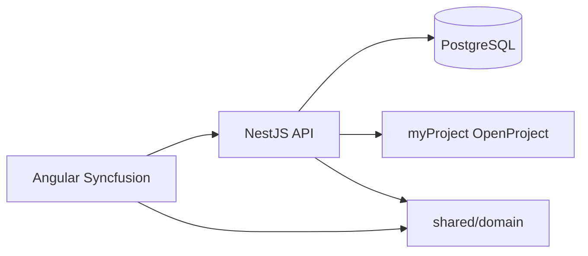

# เอกสารระบบ Man-day Scorecard

ภาพรวมสถาปัตยกรรม ขอบเขตโดเมน และจุดต่อเชื่อมหลักของโปรเจกต์  
คู่มือติดตั้ง/ใช้งาน: [คู่มือ.md](คู่มือ.md) · แผนงานต่อ: [แผนงาน.md](แผนงาน.md)

---

## เป้าหมายระบบ

ให้คะแนนใบงานด้วย **man-day** แยกสาย **Implement** / **R&D** แสดงดัชนีรายคนและทีม  
ซิงก์งานจาก **myProject (OpenProject)** อ่านเป็นหลัก ยังไม่บังคับเขียนกลับ

---

## สถาปัตยกรรม



| ชั้น | พาธ | บทบาท |
|---|---|---|
| เว็บ | `src/app/` | Angular 22.2.6 · signals + OnPush + Zone · **Syncfusion Wrappers 24 คอมโพเนนต์ (`src/app/shared/sf/`)** ควบคุมด้วย Options pattern และ Theme switching zero-reload · **Motion Architecture (`src/app/shared/motion/`)** ประกอบด้วย Reveal, Stagger, Live Pulse, Animated Number, Route Glide, Scroll Progress, Scroll-to-Top · Syncfusion Tailwind 3 Dual Theming (`darkMode` ตาม `.e-dark-mode`) · MyHR sidebar gradient · Surface tokens (`--radius-*` / `--shadow-*` / `--ease-crisp`) · `app-kpi-stat` / `app-section-card` · Sticky Sidebar **244px / พับ 64px** พร้อม Sliding Active Pill · DataGrid cell templates (`person`, `badge`, `progress`, `ticket-link`, `metric`) · **รายละเอียดใบงานกลาง** (`TicketDetailService` + drawer ขวา `app-ticket-detail-dialog`) · Global Filter Whitelist · 2-Stage Person Workspace · AppBar แจ้งเตือนไอคอน+badge · Toast typed (`ShellNotice`) |
| API | `server/` | Auth, repos, OpenProject sync, cron, Python Analytics engine |
| โดเมนร่วม | `shared/domain/` | สูตรคะแนน, workflow, มุมมองงาน, Python Analytics — **pure ไม่พึ่ง Nest/Angular** |
| ข้อมูลตัวอย่าง | seed ใน server + `shared/seed` / mock | คน 15 · ใบงานตัวอย่าง |
| เอกสาร | `docs/` | คู่มือ, walkthrough, โหมดจำลอง, รายงาน UX/UI checklist |
| ตรวจกติกา | `scripts/verify-scores.ts` | ล็อกเลขอ้างอิง เช่น IMP-100 / RD-SPIKE = 100 |

---

## โมดูลโดเมน (`shared/domain/`)

| ไฟล์ | ใช้ทำอะไร |
|---|---|
| `models.ts` | Person, Ticket, Track, Size, workflow enums |
| `scoring.ts` | คะแนนใบ / ดัชนีคน Implement·R&D · โควตา |
| `workflow.ts` | สถานะคัมบัง, วันเริ่ม/ส่ง, กฎย้ายสถานะ |
| `capacity.ts` | แผนคิวงานใหม่ · free MD |
| `alerts.ts` | deadline / overrun |
| `people-roster.ts` | แถวรายชื่อพนักงาน |
| `person-dashboard.ts` | กราฟ/กริดโปรไฟล์รายคน |
| `work-views.ts` | Summary / Gantt / Backlog / List ของ `/work` และ `/me/work` (`assigneeId` scope) |
| `delivery-timeline.ts` | สร้างเหตุการณ์ส่งมอบสำหรับ `ejs-timeline` ใน Board Dialog |
| `mock-scenario.ts` | สถานการณ์โหมดจำลอง |
| `dashboard-charts.ts` / `kpi-meaning.ts` | กราฟทีม · คำอธิบาย KPI |
| `ticket-file.ts` | นำเข้า CSV/JSON |
| `ai-tracking.ts` | มุมมอง Spike / AI |
| `gitlab-mr.ts` | จับคู่ Merge Request จาก GitLab API กับรหัสใบงาน |
| `git-branch.ts` | การจัดการ Git branch, สกัด Ticket ID อัตโนมัติ, และคำนวณหัวข้อใบงาน myProject |
| `project-detail.ts` | สถิติสุขภาพโปรเจกต์ (ProjectStats), รายละเอียดโปรเจกต์ (ProjectDetail), และข้อมูลสรุป Git ประจำโปรเจกต์ (ProjectGitSummary) |
| `workspace-scope.ts` | ขอบเขตสิทธิ์การมองเห็นข้อมูล (Allowed Teams / Projects), ฟิลเตอร์พนักงานและใบงาน |
| `analytics.ts` | Python Sync & Analytics Intelligence (Sync Hygiene, Z-score Outlier, Delivery Risk Radar, Module/Variance Bottlenecks, 1-on-1 Coaching Insights) + `scripts/analytics_engine.py` |
| `multi-team.ts` | การคำนวณ Handoff SLA, Quality & Defect Audit, 3-Way Time Audit, Dispute Impact Simulation, และ Preflight Readiness Checklist สำหรับ Enterprise Multi-Team (v2.0) |

กติกาสำคัญ: **อย่าแก้สูตรคะแนนโดยไม่รัน `npm run verify`** และอย่าใส่ logic โดเมนลง UI หรือ Nest โดยตรงถ้าใช้ร่วมได้

---

## หน้าเว็บหลัก (Unified Single-Menu & Role-Scoped Views)

ทุกสิทธิ์ (`member`, `lead`, `admin`) ใช้ **เมนูหลักชุดเดียวกัน** ไม่แยก `/me/*` ซ้ำซ้อนกับเมนูทีม โดยหน้าจอเดียวกันจะกรองข้อมูลและเปิดเครื่องมือตามสิทธิ์จริงอัตโนมัติ (ลิงก์เดิม `/me/*` จะ Redirect เข้าสู่เส้นทางรวมอัตโนมัติ):

### 1. หมวด `พื้นที่ทำงาน` (ทุกสิทธิ์ใช้ร่วมกัน: `member` · `lead` · `admin`)
- **หลังเข้าสู่ระบบทุกสิทธิ์ไป `/me` ก่อน** (รวม Dev Quick Login และ GitLab SSO → `${APP_URL}/me`) เพื่อดูงานของตัวเองก่อน — เมนูตั้งค่าระบบยังอยู่ใน Sidebar ให้เปิดเองเมื่อต้องการ
- **ชื่อบนจอ (Wording)**: route คงเดิม แต่ป้ายที่ผู้ใช้เห็นใช้คำง่าย — `/cockpit` = **ภาพรวมงาน** · `/me` = **งานของฉัน** · disputes = **ขอทบทวนคะแนน** · audit = **ตรวจคุณภาพ QA** · backlog = **งานรอจัด** · handoff = **งานค้าง & SLA**
- เมื่อเข้าด้วยสิทธิ์ **`member`**: ระบบแสดงป้าย `มุมมองของฉัน` และกรองเฉพาะใบงาน/คะแนนของตนเองอัตโนมัติ
- เมื่อเข้าด้วยสิทธิ์ **`lead` / `admin`**: แถบ Global Filter ด้านบนจะปลดล็อกตัวกรอง **`ทีม`**, **`พนักงาน`**, ปุ่มสลับด่วน **`เฉพาะฉัน`**, และชิป **`สายงาน`** บนหน้าจอเดียวกันทันที · โปรไฟล์/ออกจากระบบอยู่ท้าย Sidebar (ไม่ซ้ำปุ่มสลับบัญชีหรืออวาตาร์บน AppBar)

| Route | สิทธิ์ | หน้าที่ |
|---|---|---|
| `/me` | ทุกสิทธิ์ | **งานของฉัน**: สรุปงานเปิด เป้า MD สัปดาห์ และคำแนะนำสั้นๆ |
| `/cockpit` | ทุกสิทธิ์ | **ภาพรวมงาน**: ตัวเลขหลัก ภาระงาน แนวโน้ม และเรดาร์ความเสี่ยง (Member เห็นของตน · Lead/Admin เห็นทีม/องค์กร พร้อมสลับไป `/team`) |
| `/work/*` | ทุกสิทธิ์ | **กระดานงาน & แผน**: `summary` · `timeline` · `backlog` · `board` · `list` · `team-time` (และแท็บ `handoff` เฉพาะ `lead`/`admin`) |
| `/schedule` | ทุกสิทธิ์ | **ปฏิทิน & วันลา**: ไทม์ไลน์ใบงานและการโหลดงาน (Member ล็อกเฉพาะตนเอง · Lead/Admin กรองรายทีม/รายคนได้) |
| `/quality/*` | ทุกสิทธิ์ | **คุณภาพ & คะแนน**: `tickets` (ตารางคะแนน) · `time-audit` (เช็กเวลา 3 ทาง) · `disputes` (อุทธรณ์คะแนน) และแท็บ `audit` (`QA / DoD`) เฉพาะ `lead`/`admin` |
| `/insights/*` | ทุกสิทธิ์ | **วิเคราะห์ & Git MR**: `ols` (วิเคราะห์รายคน 6 มิติ + AI Coach) · `mygit` (ซิงก์ MR & Unmatched Branch) · `ai` (งาน AI & Spike) และแท็บ `report` / `mockup` เฉพาะ `lead`/`admin` |
| `/login` | ทุกสิทธิ์ | **เข้าสู่ระบบ / สลับบัญชี**: เลือกการ์ดพนักงาน หรือซิงก์พนักงาน MyProject + GitLab OAuth |

### 2. หมวด `บริหารทีม` (แสดงเพิ่มเฉพาะ `lead` และ `admin`)

| Route | สิทธิ์ | หน้าที่ |
|---|---|---|
| `/workspace/people` | `lead`, `admin` | **คนในทีม / พนักงาน & ทีม**: Directory แท็บ **พนักงาน \| ทีม** → Workspace รายบุคคล · แอดมินเข้าจุดเดียวจาก Sidebar「พนักงาน & ทีม」· `/org/teams` redirect มาแท็บทีม |
| `/work/queue` | `lead`, `admin` | **คิวจ่ายงาน** (แท็บในฮับ `/work`): จัดสรรใบงานใหม่ ตรวจ WIP และโควตาคงเหลือของทีม · `/queue` redirect มาที่นี่ |
| `/cockpit` | `lead`, `admin` | **ภาพรวมงาน**: แดชบอร์ดภาพรวมสำหรับ Lead: สัดส่วนภาระงาน, แนวโน้มคะแนน, คุณภาพส่งมอบ, เวลาค้างแต่ละขั้น, โหมดทีวี & ขยายกราฟ |
| `/team` | ทุกสิทธิ์ | **ทีมของฉัน**: การ์ดทีมที่ดูแล + รายชื่อสมาชิกคลิกได้ (lead/admin → Person WS) · กราฟ/KPI · จับ KPI Snapshot (admin\|lead) · member เห็นสมาชิกทั้งทีมตัวเอง |
| `/work/*` | `lead`, `admin` | **ฮับบริหารงาน**: Summary · Timeline (Gantt ปรับแก้วันได้) · Backlog ทีม · Kanban Board (Swimlane + Dialog) · List View (มีเมนูลัดสู่ `/work/board` และ `/work/timeline` บนแถบเมนู) |
| `/tickets` | `lead`, `admin` | **ตารางคะแนนทีม**: ตารางคะแนนรวมทั้งทีม รองรับ Excel Export, Frozen Columns, Column Chooser, และผลรวมท้ายตาราง |
| `/schedule` | `lead`, `admin` | **ปฏิทินทีม**: ตารางเวลาทำงาน แผนส่งมอบ และเวรซัพพอร์ตของทีม |
| `/queue` | `lead`, `admin` | **คิวงานใหม่**: วิเคราะห์ความจุและกระจายงาน พร้อมปุ่มด่วน **⚡ รับงานด่วน MD & เลื่อนงานเดิม** + Writeback Confirm |
| `/work/handoff` | `lead`, `admin` | **ส่งต่อ & SLA ข้ามทีม**: กราฟ Stage Aging แนวนอน 5 สายงาน, Blocker Matrix ข้ามทีม, และปุ่ม Ping Teams |
| `/quality/audit` | `lead`, `admin` | **ตรวจสอบคุณภาพ QA**: First-Time Right %, Reopen Rate, Defect Escape หลุด Prod, และ DoD Gate Verifier |
| `/people` | `lead`, `admin` | **ตารางพนักงาน** (คู่กับ `/team` `/cockpit`): รายชื่อ สถิติ WIP, ความแม่นยำ, ปิดตามแผน, และโปรไฟล์รายบุคคล (`/people/:id`) |
| `/tickets/disputes` | `lead`, `admin` | **ศูนย์อุทธรณ์คะแนน**: ตรวจสอบและอนุมัติคำขออุทธรณ์ของสมาชิก พร้อมแผงคำนวณ Projected Score Diff |
| `/mockup` | ทุกสิทธิ์ | **โหมดจำลอง**: ทดสอบและประเมินผลคะแนนในสภาวะจำลอง |

### 3. โหมดแอดมิน (`Admin Workspace`)
สำหรับผู้ดูแลระบบและผู้บริหารระดับสูง:

| Route | สิทธิ์ | หน้าที่ |
|---|---|---|
| `/cockpit` | `admin` | **ภาพรวมงาน**: แดชบอร์ดภาพรวมองค์กรและทีม |
| `/analytics` | `admin` | **ศูนย์วิเคราะห์ Python**: Sync Hygiene %, Z-Score Outlier, Delivery Risk Radar, Module Bottlenecks ผ่าน `scripts/analytics_engine.py` |
| `/analytics/time-audit` | `admin` | **ตรวจสอบเวลา 3 ทาง**: เปรียบเทียบ Estimate vs OP Actual vs GitLab Commit Span ระดับองค์กร |
| `/tickets` | `admin` | **ตารางคะแนนรวมทั้งองค์กร**: ตรวจสอบคะแนนใบงานทุกสายงานพร้อมส่งออก Excel |
| `/people` | `admin` | **ตารางพนักงาน** (คู่ `/cockpit`): รายชื่อ ความแม่นยำ และ Role Matrix |
| `/admin/snapshot-check` | `admin` | **ตรวจสอบก่อนแช่แข็ง**: Pre-Snapshot Freeze Gate ตรวจสอบความพร้อม 4 ด่าน และตาราง Preview Diff รายคนก่อนแช่แข็ง |
| `/admin/projects` | `admin` | **แคตตาล็อกโปรเจกต์**: จัดการสถานะเปิด/ปิด Active, ผูก Assigned Teams แบบ MultiSelect, และ Smart Merge Sync ดึงสดจาก OpenProject พร้อมนับตั๋วงาน WIP |
| `/org/projects/:id` | `admin`, `lead` | **รายละเอียดโปรเจกต์ & แดชบอร์ด (Project Detail & Git Governance Hub)**: แดชบอร์ดสุขภาพโปรเจกต์ 4 แท็บ (ภาพรวม & KPI สุขภาพ, ตารางใบงาน Work Packages ผูก Drawer 360°, การกำกับดูแล Git หลาย Repositories & CI/CD & สร้างใบงานอัตโนมัติจาก Unmatched Branches, และทีม/บุคลากรที่รับผิดชอบ) |
| `/integrations` | `admin` | **Integrations**: จัดการเชื่อมต่อ OpenProject, ซิงก์รายชื่อผู้ใช้, GitLab API, และ Microsoft Teams Webhook |
| `/admin/rubrics` | `admin` | **เกณฑ์ประเมินไดนามิก**: Rubric Registry ปรับแก้น้ำหนักและค่าเกณฑ์คะแนนแบบ Inline Real-time |
| `/teams` | `admin` | **แจ้งเตือน Teams**: จำลองและส่ง Webhook แจ้งเตือนกำหนดส่งและงานล่าช้า |
| `/mockup` | `admin` | **โหมดจำลองระบบ**: ทดสอบและประเมินผลคะแนนในสภาวะจำลอง |
| `/admin` | `admin` | **หลังบ้าน**: ตั้งค่าโควตา, น้ำหนักคะแนน, Role Matrix (ปรับสิทธิ์รายคน), และ Audit Log |

---

## เซิร์ฟเวอร์

| กลุ่ม | พาธโดยประมาณ | บทบาท |
|---|---|---|
| Auth | `server/src/auth/` | GitLab OAuth / Dev login · session · role · persona switching |
| Data | `server/src/data/` | people, work items, settings, sessions, kpi snapshots, due shifts, git branches |
| OpenProject | `server/src/integrations/openproject/` | client · mapper · sync (Work packages, User Sync, Work Package Creation) |
| GitLab | `server/src/integrations/gitlab/` | client · MR sync · branch sync · webhook handler |
| KPI | `server/src/kpi/` · `shared/domain/kpi-snapshot.ts` | จับ/แช่แข็ง PersonScore ตามเดือน·ไตรมาส |
| API | `server/src/api/` | HTTP controllers: tickets, people, sync, analytics, ai coach, integrations, project catalog |
| DB | `server/src/db/` | migrate (migrations 001–010) · seed |

### การซิงค์ผู้ใช้ OpenProject & ฐานข้อมูล Profile (Migration 007)

- **Migration 007 (`007_people_profile_fields.sql`)**: เพิ่มคอลัมน์ `avatar_url`, `department`, `job_title` ลงในตาราง `people` เพื่อรองรับข้อมูลองค์กรจริง
- **Endpoint**: `POST /api/integrations/openproject/sync-users`
- **กฎ Pagination ใน OpenProject API v3**: พารามิเตอร์ `offset` ใน OpenProject API v3 คือ **1-based page number** (1, 2, 3...) ต้องวนลูปด้วย `offset += 1` เสมอ (ห้ามใช้ `offset += pageSize`) เพื่อป้องกันปัญหาดึงข้อมูลผู้ใช้ตกหล่น
- **แมป Custom Fields ของพนักงาน**:
  - `_links.customField1` &rarr; แผนก (`department`)
  - `_links.customField2` &rarr; ฝ่ายย่อย (`division`)
  - `_links.customField3` &rarr; ตำแหน่งงานจริง (`job_title`)
- **Avatar Fallback**: เมื่อภาพจาก OpenProject ไม่สามารถโหลดได้ ฝั่ง UI มีตัวตรวจจับ `(error)="onAvatarError()"` เพื่อแสดงตัวย่อ 2 ตัวอักษรบน Gradient MyHR Royal Blue โดยอัตโนมัติ
- **Team Staging & Active Filter**: ควบคุมด้วย `OPENPROJECT_TEAM_STAGING=rd|all` (ค่าเริ่ม `all`) — โหมด `all` เปิดสมาชิก/ใบงานทุกทีมและไม่ดรอป WP เพราะ assignee ยังไม่แมป; โหมด `rd` (POC) พนักงานแผนกอื่นถูกตั้ง `active = false` (ไม่ลบข้อมูล) โดย `listPeople(db, true)` กรองเฉพาะคนที่ active
- **Global Workspace Filter**: สัญญาณ `teamId` / `project` / `track` / `person` / `cycle` / `year` / `from` / `to` ใน URL + `WorkspaceFilter` — กรอง `/work` `/tickets` `/people` `/team` `/cockpit` `/quality` `/mygit` `/schedule` · **ค่าเริ่มต้น `teamId` ว่าง** (ทุกทีมในองค์กร/สิทธิ์) · `clear()` ไม่คืนทีมตัวเอง · ชิปสาย 6 รหัส · member บังคับ `personId=self` ใน `scope()`
- **เจ้าของตัวกรองตามหน้า (ไม่สร้างหน้ากรองกลาง)**: `/work` เหลือสัปดาห์/ถังวัน/ค้นหา (`WorkHubFilter` ไม่ persist team/track) · Person WS เลือกคนแค่ route (เขียน Global `person` เฉพาะตอนเจาะ `/work`) · handoff ฐานจาก `applyToTickets` · schedule โหมดทีม sync `setTeam`/`setPerson` สองทาง · `/admin/projects` กรองทีมของหน้าเอง
- **Scorecard Cycle (เปิดรอบประเมิน)**: เก็บใน `settings.scorecardCycles` · API `GET/POST/PUT/DELETE /api/scorecard-cycles` + `POST …/:id/activate` · แอดมินเปิดรอบปี/ช่วงวัน/ขอบเขตทีมบน `/admin` แล้วเลือกใช้บนแถบ Global Filter
- **โดเมน scope**: `shared/domain/workspace-scope.ts` — `listWorkspaceTrackChipOptions` · `filterPeopleByWorkspace` · `filterTicketsByWorkspace` · `listOrgTeamOptions` / `listTeamWorkspaceCards`
- **API visibility**: bootstrap / work-items list / org people กรองด้วย `computeEffectiveAllowedTeams` ก่อนส่ง (admin ยกเว้น)

### ระบบจัดการสิทธิ์การมองเห็นข้อมูลระหว่างทีม (Team-Based Visibility Scoping)
- **Dual Security Enforcement**:
  - การจำกัดสิทธิ์การมองเห็นข้อมูลระหว่างแผนกถูกควบคุม 2 ระดับ:
    1. **API / Database Level**: ตาราง `team_visibility_rules` และ `user_allowed_teams` พร้อมฟังก์ชัน `computeEffectiveAllowedTeams()` ที่ Backend โดย Admin มองเห็นทุกทีม (`null`), Lead/Member ถูกกรองเฉพาะทีมตนเอง + ทีมที่ได้รับอนุญาต
    2. **UI Reactive Level**: ควบคุมการกรองคนและใบงานผ่าน `WorkspaceScope.allowedTeams` และฟังก์ชัน `filterPeopleByWorkspace()`, `filterTicketsByWorkspace()`
- **2D Team-to-Team Sharing Matrix UI (`/admin`)**:
  - ตาราง 2 มิติ (แถว = แผนกต้นทาง, คอลัมน์ = แผนกปลายทาง): ช่องทแยงมุมเป็นทีมตนเอง (เปิดถาวร), ช่องข้ามแผนกใช้ Checkbox สำหรับเปิด/ปิดสิทธิ์การเข้าถึงข้ามทีม พร้อมปุ่มบันทึกและระบบ Audit Log
- **User Override MultiSelect**:
  - ตารางพนักงานบนหน้า `/admin` มีคอลัมน์ MultiSelect กำหนดสิทธิ์เพิ่มเติมเป็นรายบุคคล
- **Scoping บน Global Filter & Omnisearch**:
  - Dropdown **ทีม** ปรับตัวเลือกเป็น "ทุกทีมในสิทธิ์" อัตโนมัติสำหรับผู้ใช้ที่มีสิทธิ์จำกัด และ Omnisearch (`⌘K`) กรองผลลัพธ์พนักงานและใบงานเฉพาะทีมที่ได้รับอนุญาต

### ระบบแคตตาล็อกโปรเจกต์ (Project Catalog & Visibility Scoping - `/admin/projects`)
- **การจัดการโปรเจกต์**: ผู้ดูแลระบบสามารถเปิด/ปิดสถานะ Active และกำหนดทีมที่รับผิดชอบ (`assignedTeamIds`) ให้กับโปรเจกต์ myProject
- **Smart Merge Sync (`POST /api/org/projects/sync`)**:
  - ดึงรายชื่อโปรเจกต์สดจาก myProject API v3 (`GET /api/v3/projects`) และทำการผสานข้อมูล (Smart Merge) โดยรักษาค่าสถานะ `active` และทีมที่รับผิดชอบเดิมที่ Admin เคยตั้งไว้
- **Live Active WIP Aggregation**:
  - รวมยอดตั๋วงานคงค้าง (`activeTicketsCount`) จาก `work_items` ที่ `closed = false` โดยจับคู่กับ `opProject` เพื่อแสดงภาระงานปัจจุบันทันที
- **Global Project Filter Scoping**:
  - โปรเจกต์ที่ปิด `active = false` จะถูกซ่อนออกจาก Dropdown เลือกโปรเจกต์ในทุกหน้าจอ
  - ผู้ใช้ทั่วไป (`member` / `lead`) จะมองเห็นเฉพาะโปรเจกต์ที่ Active และผูกกับทีมในสิทธิ์ (`effectiveAllowedTeams`) หรือโปรเจกต์ส่วนกลาง

### ระบบ Git & myProject Smart Integration (mygitplus & OpenProject v3)
- **การตรวจจับ Branch และผูกใบงานอัตโนมัติ**:
  - เมื่อมีการ Push branch ใน mygitplus (รองรับทั้ง GitLab Webhook และ On-demand Sync `POST /api/integrations/gitlab/sync-branches`):
  - ระบบตรวจจับ Ticket ID ในชื่อ branch ด้วย Regex ผ่าน `parseTicketIdFromBranch()` (เช่น `feature/IMP-101-slug` $\rightarrow$ `IMP-101`) หากพบจะผูกเข้ากับใบงานทันที
- **การจัดการ Unmatched Branches (1-Click Smart Dialog)**:
  - Branch ที่ยังไม่มีใบงานรองรับ จะแสดงในหน้า `/mygit` และแท็บ `Git & โค้ด` ใน `/workspace/people` พร้อมปุ่ม `+ สร้างใบงาน`
  - เมื่อคลิก จะเปิด `TicketCreateDialogComponent` (โมดอล Syncfusion) แปลงชื่อ branch เป็นหัวข้อใบงานอัตโนมัติ (เช่น `feature/payment-slip-export` $\rightarrow$ `Payment slip export`) พร้อมเลือกโปรเจกต์และผู้รับผิดชอบให้อัตโนมัติ
  - เมื่อกดยืนยัน ระบบจะเรียก `POST /api/integrations/openproject/create-from-branch` เพื่อสร้าง Work Package บน myProject API v3 และผูกเชื่อมโยงกับ branch ทันที
- **สร้าง Branch จากใบงาน (ทิศกลับ)**:
  - ใน drawer แท็บ「โค้ด & MR」เมื่อใบมี `opId` สามารถเลือก repo GitLab แล้วสร้าง branch ด้วยชื่อจาก `suggestBranchNameFromTicket()` (เช่น `feat/OP-73306-…`) ผ่าน `POST /api/integrations/gitlab/create-branch-from-ticket`
  - สมาชิกสร้างได้เฉพาะใบที่มอบหมายตัวเอง · ไม่มี token จะจำลองในฐานข้อมูล (offline) โดยไม่ยิง GitLab
- **Offline / Unconfigured Mode Fallback & Resilient Security**:
  - ฟังก์ชัน `connectionToken()` ครอบการถอดรหัสด้วย `try/catch` คืนค่าว่างหาก Token ผิดรูป ป้องกันข้อผิดพลาด `sealed secret is malformed` ไม่ให้ระบบส่งคืน HTTP 500
  - มีระบบจำลองข้อมูล Branch อัตโนมัติเมื่ออยู่ในโหมดทดสอบที่ไม่ได้เชื่อมต่อเซิร์ฟเวอร์ mygitplus จริง

### ศูนย์ข้อมูลรายละเอียดโปรเจกต์และการกำกับดูแล Git (Enterprise Project Detail & Git Governance Hub - `/org/projects/:id`)
- **ภาพรวมและแดชบอร์ดสุขภาพโปรเจกต์ (Tab 1: ภาพรวม & สุขภาพ)**:
  - **Hero KPI Strip**: คำนวณความคืบหน้ารวม (% และจำนวนใบงานปิด/ทั้งหมด), ประมาณการเทียบใช้จริง (Est. vs Act. Spent MD), ใบงาน WIP คงค้าง, และรายการงานติดขัด/บั๊ก
  - **Man-day Progress & Effort Breakdown**: แถบความคืบหน้า Man-day เทียบ Actual Spent MD ต่อ Total Estimate MD
  - **Stage Distribution & Track Breakdown**: สถิติกระจายงานตามขั้นตอน 6 ขั้นตอน (New, In Progress, Ready for QA, In QA, Done, Reopened) และแยกตาม 6 สายงาน (IMP, RND, QA, UXBA, SUP, INFRA)
  - **Risk & Blocker Watchlist**: ตารางเฝ้าระวังงานติดขัด (`blocker = true`) หรืองานค้างนานเกิน 5 วัน (`delayedAgingDays > 5`) พร้อมปุ่มเจาะลึกดูรายละเอียดใบงาน 360°
- **ตารางใบงานทั้งหมดในโปรเจกต์ (Tab 2: ใบงานในโปรเจกต์)**:
  - Syncfusion DataGrid รายการใบงานทั้งหมดที่ผูกกับโปรเจกต์นี้ แสดงรหัสตั๋ว, หัวข้อใบงาน, สายงาน, สถานะ, ผู้รับผิดชอบ (พร้อมรูป Avatar), Est. MD, Act. MD, และกำหนดส่ง
  - คลิกที่รหัสใบงานเพื่อเปิด Ticket 360° Drawer ทางด้านขวาได้ทันที
- **การกำกับดูแล Git หลาย Repositories & CI/CD (Tab 3: Git & กิ่งโค้ด)**:
  - **Multi-Repo Mapping**: ตัวเลือก Syncfusion MultiSelect (`app-sf-multiselect`) กำหนด Git Repositories ใน mygitplus ที่เกี่ยวข้องกับโปรเจกต์นี้ (`gitRepoIds`, `gitRepoNames`) บันทึกผ่าน `PUT /api/org/projects/:id`
  - **CI/CD Pipeline Health**: แสดงการ์ดสถานะ Pipeline ล่าสุดของแต่ละ Repository (Success, Running, Failed, Canceled) พร้อมเวลาที่รันล่าสุด
  - **Active Git Branches**: รายการกิ่งโค้ดที่กำลังเคลื่อนไหว โดยระบุกิ่งที่ผูกกับใบงานแล้ว และกิ่งที่ยังไม่มีใบงานรองรับ พร้อมปุ่ม `+ สร้างใบงาน` แบบ 1-Click เปิด Smart Pre-filled Modal
- **ทีมและกำลังพลที่รับผิดชอบ (Tab 4: ทีม & บุคลากร)**:
  - แสดงทีมและแผนกที่ได้รับมอบหมายให้ดูแลโปรเจกต์นี้
  - สรุปรายชื่อพนักงานที่มีใบงานในโปรเจกต์ พร้อมจำนวนตั๋วและยอด Man-day สะสม
- **Unified Entry Points & Omnisearch Integration**:
  - ลิงก์ตรงจากตาราง `/admin/projects` ด้วยปุ่ม "แดชบอร์ด 📊" ในคอลัมน์จัดการ และคลิกที่ชื่อโปรเจกต์
  - ค้นหาข้ามระบบผ่าน Omnisearch (`⌘K`) ทั้งชื่อโปรเจกต์, slug, และรหัส ID (เช่น `324` หรือ `AVA`) พร้อมแผงลอยทับหน้าจออย่างสมบูรณ์

### ระบบ Self-Service Ticket Management & Direct Dispute
- **Self-Service Modal Dialog**: บนหน้า `/me/tickets` และ `/me` พนักงานสามารถอัปเดตงานตนเองได้โดยตรง: ปรับสถานะได้ถึง `In QA` (ไม่สามารถปิด `Done` เอง), บันทึกเวลาจริง `actualMd`, แนบลิงก์ MR, บันทึกวันพักงาน `pausedDays`, สาเหตุ Bug (`bugCause`), ผลลัพธ์ PoC (`pocResult`), และตรวจสอบเช็คลิสต์ Definition of Done (DoD: `unitTest`, `mrLinked`, `stagingVerified`)
- **Direct Dispute Linking**: ปุ่มยื่นอุทธรณ์ในแต่ละแถวของตารางตั๋วตนเองจะส่งต่อไปยัง `/me/disputes?ticketId=...` และเลือกรหัสใบงานในฟอร์มยื่นอุทธรณ์ให้อัตโนมัติ

### แมป OpenProject → Ticket (สรุป)

- มาตรฐาน: Assignee, Status→workflow, Type, **Priority**, estimated/spent → MD, start/due/closed  
- Custom fields (ตั้งใน Integrations): Size, Track, Variance, Unplanned, Story points, Discipline, Work category, Review rounds, Blocker, DoD, **Unit Test / Check pass (อ่านอย่างเดียว)**, Spike flags, MR, Bug cause, PoC, Week offset, First due  
- ฟิลด์ส่วนขยาย v2026.4: `baselineDue` (กำหนดส่งแรกเริ่ม), `exceptionTag` (แท็กขอยกเว้น SLA), `rdWorkTrack` (แทร็กย่อย R&D), `spikeOutcome` (ผลลัพธ์การค้นคว้า Spike)
- OpenProject Activity Comment Writeback: บันทึกข้อความ Markdown ลง `/api/v3/work_packages/:id/activities` อัตโนมัติเมื่อมีการสั่งพักงานหรือเลื่อนส่งมอบจากคำสั่ง MD Mandate
- รายละเอียดในคู่มือตารางฟิลด์ และ `DEFAULT_OPENPROJECT_MAPPING`

### AI Coach & OLS Trendline Engine (v2026.4)

- **OLS Regression Trendline**: คำนวณความชัน Least-Squares Slope ($y = mx + c$) ย้อนหลัง 6 เดือนบนหน้า `/people/:id` เพื่อตรวจจับแนวโน้มพัฒนาการเชิงสถิติ (เส้นประสีม่วง `#a855f7`) พร้อมป้ายสถานะ Slope รายเดือน
- **AI Coach 1-on-1 Dialogue (`/api/ai/coach-summary`)** และ AI Copilot (`/api/ai/chat` · briefing · draft · dispute): เรียก Google Gemini 2.5 Flash โดยตรงเมื่อมี `GEMINI_API_KEY` — หรือผ่าน **ai-core-service** เมื่อตั้งครบทั้ง `AI_CORE_URL` + `AI_CORE_API_KEY` (โปรดักต์ grounding/prompts ยังอยู่ใน myTask) · ล้มเหลวหรือไม่มีคีย์ → Fallback เป็น Rule-based Synthesis ภาษาไทย (สูตรคะแนนไม่เปลี่ยน)

---

## สิทธิ์

| Role | สิทธิ์หลัก |
|---|---|
| `admin` | แก้ settings / mapping / จับคู่ user · ย้ายสถานะทุกขั้นรวม `Done` · แก้วันเริ่ม/ส่งบน Gantt |
| `lead` | อ่าน+ซิงก์ · assign/รับคิว (+ยืนยัน writeback) · ย้ายสถานะทุกขั้นรวม `Done` · แก้วันเริ่ม/ส่งบน Gantt |
| `member` | อ่าน+ซิงก์ · ย้ายการ์ดตัวเองบน Board ได้ถึง `Ready for QA` / `In QA` (ห้ามปิด `Done` เอง) · แก้ฟิลด์ส่งมอบ (`mrLink`, `pocResult`, `bugCause`) |

---

## โฟลว์รับมืองานสั่งตรงจาก MD (MD Mandate & Auto-Shift Workflow)

เมื่อมีงานด่วนสั่งตรงจาก MD แทรกเข้ามากลางสัปดาห์ ระบบมีกลไกคุ้มครองความเป็นธรรมของคะแนน KPI ดังนี้:

1. **การระบุงาน**: ติ๊ก `isMdDirect: true` บนการ์ดใน `/work/board` หรือกดปุ่ม `⚡ รับงานด่วน MD & เลื่อนงานเดิม` ใน `/queue` การ์ดจะแสดงป้าย `[MD-DIRECT]`
2. **Active WIP Auto-Detection**: เมื่อลากการ์ด MD เข้า `In Progress` ระบบจะตรวจจับงานค้างในมือ (`In Progress` / `Reopened`) ของน้องคนนั้นอัตโนมัติ และแสดง Dialog ให้เลือกพักงาน
3. **Auto-Pause & Shift firstDueOn**: เมื่อกดยืนยัน งานเดิมจะเปลี่ยนสถานะย่อยเป็น `[PAUSED]` และระบบจะคำนวณเลื่อนวันส่งแรก (`firstDueOn`) ออกไปตามขนาดงาน MD ด้วยฟังก์ชัน `addWorkingDays` (ข้ามวันเสาร์-อาทิตย์เสมอ) พร้อมบันทึกประวัติลง `ticket_due_shifts` และ Audit Log
4. **Scoring Protection Rules**:
   - **On-time**: งานเดิมที่ถูกพัก (`isPaused: true`) การันตีเต็ม 40 คะแนน ไม่ถูกตัดคะแนนส่งช้า
   - **Accuracy**: วันที่ถูกพัก (`pausedDays`) จะถูกนำมาหักลบออกจาก `actualMd` กลายเป็น Net Actual MD ก่อนคำนวณอัตราส่วน การันตีไม่เสียคะแนนความแม่นยำ (20 คะแนน)
   - **MD Credit**: ใบงาน MD นับเข้าโควตาผลงานเต็มจำนวน และแยกแสดงผลวิเคราะห์ MD Share (%) บน Dashboard ทีมและรายบุคคล

---

## กลไกความแม่นยำและโควตาพิเศษ (Accuracy & Review Quota)

1. **Tiered Tolerance Accuracy Engine**:
   - **XS / S ($\le 0.5$ MD)**: กรอบกว้าง $[0.5, 2.0]$ ได้เต็ม 20 คะแนน (ยอมรับความแปรปรวนสูงของงานเล็ก)
   - **M ($1.0$ MD)**: กรอบมาตรฐาน $[0.8, 1.5]$ ได้เต็ม 20 คะแนน
   - **L / XL ($\ge 2.0$ MD)**: กรอบวินัยเข้ม $[0.85, 1.3]$ ได้เต็ม 20 คะแนน
   - คำนวณ Net Actual MD โดยหักลบวันพักงาน (`pausedDays`), เวลาติดบล็อก (`blockedHours`), และเวลารอคิว QA
2. **GitLab Approvals & Peer Review Quota**:
   - ซิงก์รายชื่อผู้ตรวจโค้ด (`reviewers`) และผู้อนุมัติ (`approved_by`) ผ่าน GitLab API `/api/v4/projects/:id/merge_requests/:iid/approvals`
   - มอบเครดิตเวลาโควตา **Peer Review MD** (10–15% ของ `estimateMd`) ให้ Senior ในทีมเพื่อความเป็นธรรมในการทุ่มเทเวลาตรวจโค้ด
3. **OpenProject firstDueOn Protection**:
   - เมื่อซิงก์ข้อมูลจาก myProject/OpenProject: หาก `firstDueOn` มีค่าอยู่แล้ว ห้ามเขียนทับโดยเด็ดขาด ยกเว้นมีคำสั่งอนุมัติจากตาราง `ticket_due_shifts` สถานะ `APPROVED`

4. **Modern Bento Grid Cockpit Architecture (100vh Viewport Fit & TV Mode)**:
   - **Zero Vertical Body Scrollbar**: บนจอเดสก์ท็อปขนาดความกว้าง $\ge 1200$px คอนเทนเนอร์ `.bento-cockpit` ใช้ `height: calc(100vh - 90px)` จัดสัดส่วน Grid 3 แถว (Tier 1: 4 Hero KPI Cards, Tier 2: 60:40 กราฟภาระงานและแนวโน้ม OLS, Tier 3: 3 คอลัมน์ DoD Gate, Stage Aging, และ AI Bottleneck Radar) ให้พอดีหน้าจอแบบไม่ต้องเลื่อนลูกกลิ้งเมาส์
   - **Glassmorphism & Dual Theming**: ใช้พื้นหลังโปร่งแสงพร้อมขอบเรืองแสง (Dark Obsidian ในโหมดมืด และ Modern White Soft-Shadow ในโหมดสว่าง) เข้ากันได้กับ Syncfusion Charts ผ่าน `ThemeService`
   - **TV Presentation Mode**: ปุ่มสลับโหมดห้องประชุม/จอทีวี (`isTvMode`) จะขยายเต็มหน้าจอ ซ่อน Navbar / Breadcrumbs และตรึง Refresh อัตโนมัติ
   - **Maximize Deep-Dive Dialog**: ปุ่ม `[ ⛶ ]` ขยายกราฟใดๆ ใน Bento ขึ้นมาเป็นโมดอลขนาดใหญ่ พร้อมตารางสรุปรายละเอียด (Breakdown Table) ให้เจาะลึกตัวเลขได้ทันที

---

## การตรวจคุณภาพ

```powershell
npm run verify
npm --prefix server run test
npm run build
npm --prefix server run build
```

อ้างอิงคะแนนต้องคง: **IMP-100 total = 100**, **RD-SPIKE spikeScore = 100** (และเคสใน `verify-scores.ts`)

---

## สถานะเฟสงาน (ดูแผนงาน)

**Release v2.3.0 (Enterprise Readiness)** ทำครบแล้วทั้ง 4 Waves ต่อยอดจาก P1–P30:
- ปรับปรุงความปลอดภัย (`HKDF-SHA256` + rotation, CSRF/SSRF/rate-limit, `VisibilityScopeService` RBAC/IDOR, CSV formula escape)
- เพิ่มประสิทธิภาพและเสถียรภาพ (Migration 013 indexes + `pg_trgm` + sequences, advisory locks, HTTP Circuit Breaker + single-flight `TtlCache`, pruned Syncfusion CSS offline-safe)
- ขัดเกลา UX/Theme/Accessibility (zero-flash Dark/Light toggle + cache-busting, Mobile overlay, Thai `L10n`, WCAG 2.1 AA focus/skip-link)
- แยกโครงสร้างโค้ดและ DevOps (`src/app/core/navigation.ts`, `TeamsIntegrationController`, `TimeEntriesController`, `X-Request-Id` + structured logs + `/api/health/metrics`, non-root `Dockerfile.api`, Nginx security headers, log rotation, GitHub Actions CI) — รายละเอียดใน [แผนงาน.md](แผนงาน.md)
